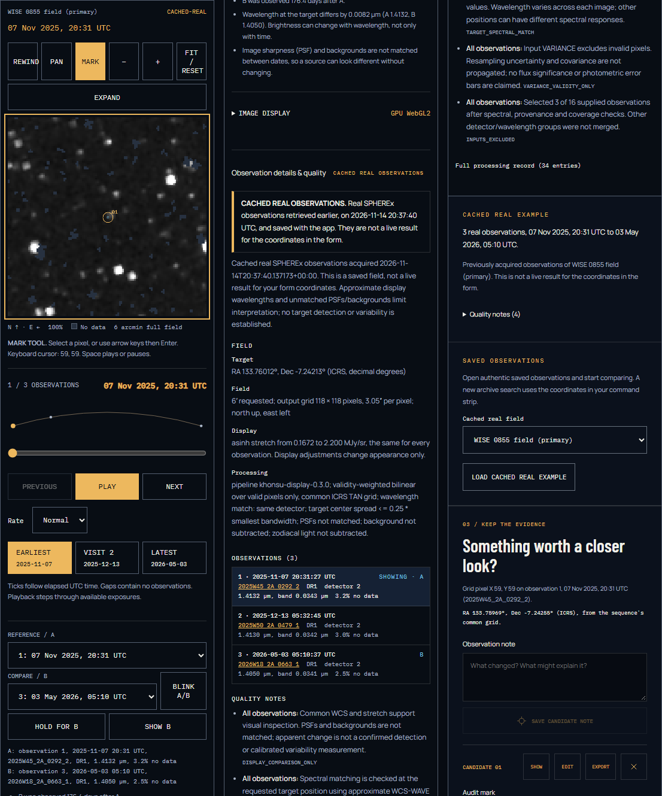

# Accessibility and responsive acceptance

Scope: [GitHub #18](https://github.com/Sammieblz/khonsu/issues/18) / Linear BYT-30. Audited November 15, 2026 (UTC), America/New_York evening of November 14.

## What was tested

The production static export of `main` (`331b4b7`) with the open pull requests that complete the journey merged locally:

- #50 and #51: candidate marks and evidence export;
- #52: provenance and credits;
- #53: A/B comparison;
- this branch.

It ran against a local API serving both cached real fields. This is local verification, not a public deployment check.

Tools:

- `scripts/audit-accessibility.mjs` with Playwright 1.62.0 and Chromium 1254;
- axe-core 4.10.3, with WCAG 2.0 and 2.1 A and AA rules;
- the existing console suite, `scripts/verify-observatory.mjs`, in Chromium and Firefox.

## Results

| Check | 390 × 844 | 820 × 1180 | 1440 × 900 |
| --- | --- | --- | --- |
| Page scrolls sideways | No | No | No |
| Primary actions hidden or off-screen | None | None | None |
| Controls under 44 × 44 px | 0 of 66 | 0 of 66 | 0 of 66 |
| axe violations, entry page | 0 | 0 | 0 |
| axe violations, loaded sequence with a candidate | 0 | 0 | 0 |

Primary actions checked: load cached example, Rewind, Pan, Mark, Next, Previous, Blink A/B, Save candidate note and Export all saved candidates. Links inside running text are excluded from the size check, as WCAG 2.5.8 allows.

**Keyboard only (1440 px).** Each step was reached with Tab or Shift+Tab and activated with Enter or the arrow keys, and focus was visible at every step:

1. **Load cached real example.** Focus then lands on the explorer, not the page body.
2. **Step to the next observation** with the arrow keys on the observation canvas.
3. **Choose Mark** and select a pixel with the arrow keys and Enter.
4. **Type a note** and save it.
5. **Export the candidate.** The downloaded file parsed as `khonsu-evidence` with the typed note.

**Motion.**

- With no motion preference, no animations run on entry or after loading.
- With reduced motion, the global rule shortens animations and transitions to 0.01 ms. The six transitions created on entry finish immediately, and none are running after loading.
- In both modes, no observation changes until the visitor asks: playback and blinking never start on their own.

**Not colour alone.**

- The bar under the image names the selected tool: "REWIND TOOL", "PAN TOOL" or "MARK TOOL", and tool buttons expose `aria-pressed`.
- Data mode, A/B roles and warnings are written out in words (#52, #53).
- Missing data is described in words and as a percentage.



## Fixes made in this pass

| Area | Change | Pull request |
| --- | --- | --- |
| Header links on narrow screens, coordinate inputs, time and display sliders, Image display and Quality notes toggles, zoom buttons, footer link | Raised to 44 px | This branch |
| Focus after loading an example | Moves to the explorer instead of the page body, because the entry panel that held the button closes | This branch |
| Disclosure toggles | Share the amber focus ring | This branch |
| Selected tool | Named in words in the bar under the image | This branch |
| Candidate Show, Edit, Export, Delete, storage and edit buttons, other-sequences toggle | Raised from 32 px to 44 px | #50 |
| Evidence preview toggle | Raised from 18 px to 44 px | #51 |

## Remaining limitations

- No physical touch device or screen reader was used. axe and keyboard checks do not replace a manual VoiceOver, TalkBack or NVDA pass.
- The keyboard and size audit ran in Chromium. Firefox ran Samuel's console suite, not this audit.
- No teammate walkthrough without guidance has happened yet. The ticket asks for one, and it belongs in the final acceptance pass (#21).
- On narrow screens, Observation details opens by default (#52), so the note form sits further down the page. It stays reachable by scrolling and by Tab; whether it should start closed on phones is a design choice for Aryan and Robel.

## Re-run

Serve the static export and the API (see [console acceptance](console-acceptance.md) for the setup), then:

```powershell
npm install --prefix .cache/browser-tools --no-save --package-lock=false playwright@1.62.0 axe-core@4.10.3
$env:PLAYWRIGHT_MODULE=(Resolve-Path .cache/browser-tools/node_modules/playwright).Path
$env:KHONSU_TEST_URL='http://localhost:3001'
node scripts/audit-accessibility.mjs
```

Install both packages in one command; a later `--no-save` install removes packages it was not given. The report and full-page screenshots go to ignored `.cache/accessibility/`. The keyboard journey needs the candidate and export features from #50 and #51.
