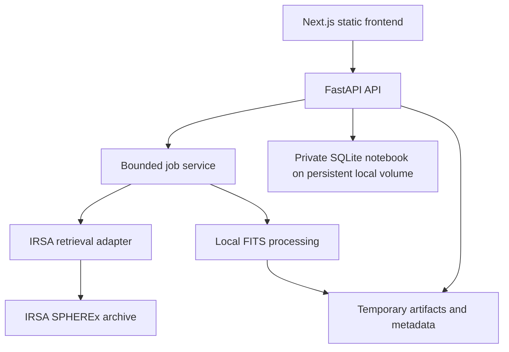

# Architecture and file arrangement

Khonsu is a monorepo with an independently deployable static web frontend and a containerized Python API. Scientific libraries run in normal CPython. The browser requests prepared images and metadata rather than downloading a FITS collection and reimplementing scientific processing.

Locally, Docker Compose runs the web development server and API. For hosting, Cloudflare Pages serves the exported frontend. A small Cloudflare Worker routes to a Cloudflare Container running the same API image. The Worker is routing glue, not a second science backend. Read `docs/deployment.md` for lifecycle and cost limits.

## Repository layout

| Location | Purpose |
| --- | --- |
| `apps/web/src/app/` | Static routes, layout and global styles |
| `apps/web/src/components/ui/` | Original shared controls, icons and brand mark |
| `apps/web/src/features/explorer/` | Search, page composition, shared selection state |
| `apps/web/src/features/viewer/` | Image rendering, frame cache and temporal interaction |
| `apps/web/src/features/annotations/` | Candidate and observation notes, browser backup, database sync and export |
| `apps/web/src/lib/api/` | Fetch boundary and generated API declarations |
| `apps/api/app/main.py` | Thin HTTP boundary and error mapping |
| `apps/api/app/notebooks.py` | Bounded private SQLite notebook and revision transactions |
| `apps/api/app/schemas.py` | Authoritative public request and response schemas |
| `apps/api/app/interfaces.py` | Retrieval-to-processing internal handoff |
| `apps/api/app/retrieval/` | Archive queries, bounded downloads and source metadata |
| `apps/api/app/processing/` | FITS reading, WCS reprojection, masks and display artifacts |
| `apps/api/tests/` | Contract, route and scientific acceptance tests |
| `contracts/` | OpenAPI snapshot, examples and generated-file policy |
| `fixtures/` | Development inputs and future real, traceable samples |
| `infra/cloudflare/` | Container-routing Worker configuration and instructions |
| `scripts/` | Deterministic contract export and repository checks |
| `.agents/skills/` | Six focused, repo-local coding-agent workflows |

## Boundaries

Routes validate and translate HTTP. The job service deduplicates identical requests, applies limits, calls retrieval and processing, and records state. Retrieval owns network access, URLs, release filters, downloads, retries and upstream timeouts. Processing has no network access and consumes local FITS paths with explicit metadata. It writes aligned PNG artifacts and a manifest with WCS, quality, dates and processing settings.

The frontend API client owns request and polling logic. The explorer composes controls and owns sequence selection. The viewer renders a given sequence and emits events. Annotations bind user evidence to a frame, sky coordinates and processing metadata. Interface decoration can animate; observation pixels are never warped to fit a cinematic transition.

## Deliberate MVP limits

Begin with one API process and one container instance, one active science job and a small bounded queue. Jobs and artifacts are temporary. A restart can lose them; return explicit expired or unknown states and offer a retry. A share link stores query parameters rather than relying on a permanent job ID. Do not scale in-memory jobs across instances without a shared job store and a new deployment decision.

Apply maximum field of view, frame count, download bytes, execution time, cache size and upstream concurrency. Never allow client-supplied filesystem paths or arbitrary remote image URLs. Do not expose development docs, stack traces or debug state as application content. Restrict cross-origin requests to configured frontend origins.

No account system, Redis, Celery, object store, or AI service is needed. Samuel explicitly scoped a [lightweight SQLite notebook](guided-notebook.md) for persistent human notes. It does not change the temporary science-job store. Local Docker uses a persistent volume; public Cloudflare notebook storage remains disabled until durable storage is provided. Optional mission adapters should conform to a source interface while preserving their distinct calibration, time, wavelength, licensing and resolution information.
