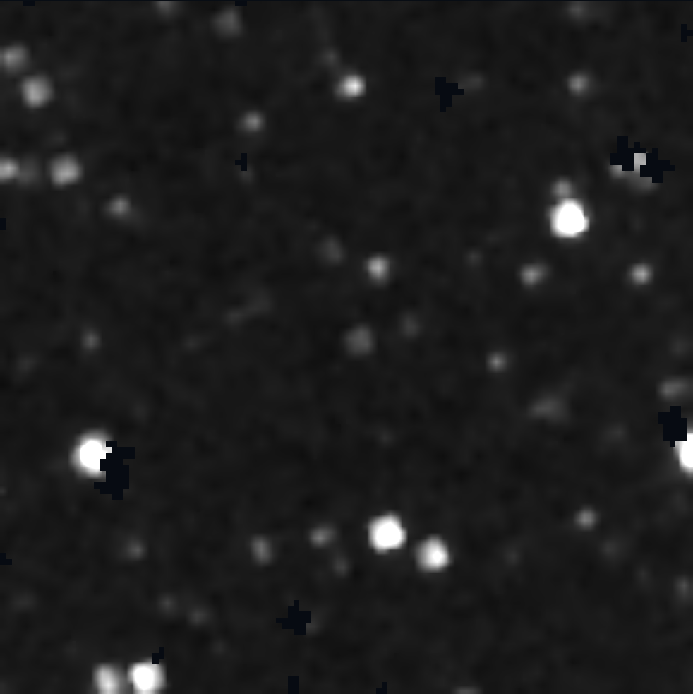
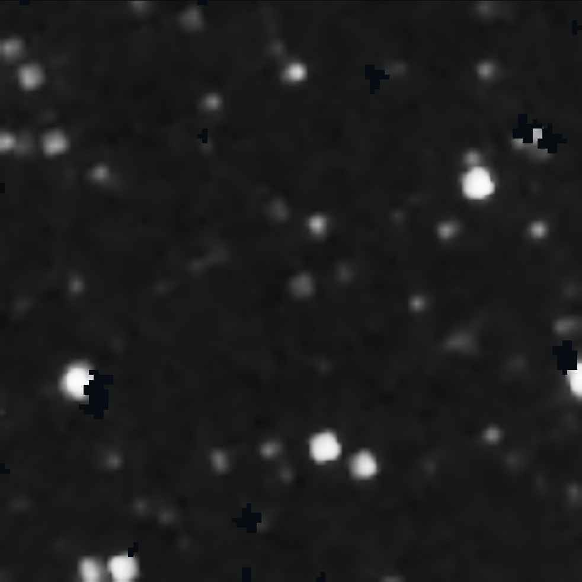
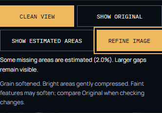

# Astro image refinement

Issue [#68](https://github.com/Sammieblz/khonsu/issues/68),
[BYT-51](https://linear.app/byteboyz/issue/BYT-51), owned by Samuel. This pass
adapts applicable computational-photography ideas to the SPHEREx time viewer.
It promotes two existing resolution-lab methods instead of adding another
image-processing engine. The observations remain independently dated.

## Try it

1. Open the Docker app at [localhost:3000](http://localhost:3000) and hard-refresh
   after rebuilding. Load the **WISE 0855** cached real example.
2. Press **REFINE IMAGE** next to **CLEAN VIEW**. Refinement starts off. It reduces
   grain and softens clipped display highlights; Clean View separately estimates
   eligible small gaps. Large gaps and rejected star cores can remain visible.
3. Press **SHOW ORIGINAL** to compare, then press it again to return. In Advanced,
   **HOLD ORIGINAL** also works with the pointer, Space or Enter. Releasing it
   restores your settings.
4. Step through the real observation dates. In **ADVANCED IMAGE DISPLAY**, try
   **REDUCE GRAIN** and **SOFT HIGHLIGHTS** individually. The same highlight curve
   is used across dates. Try **Rendering: CPU** to check the fallback.
5. Choose **MARK**. Refinement, estimated fills and warning-only samples pause.
   Saved candidates continue to use original validity and source metadata.
6. Repeat with Epsilon Indi B. Improvement depends on the source; it is not a
   conversion to native 1080p or 4K detail.

| Clean View, refinement off | Same observation, refinement on |
| --- | --- |
|  |  |



## Research and scope

[Samsung's official description](https://news.samsung.com/global/new-galaxy-s22-camera-updates-let-you-capture-the-stars-like-a-pro)
confirms multi-frame processing, sky segmentation and celestial tracking.
[Samsung support](https://www.samsung.com/uk/support/mobile-devices/professional-photography-with-galaxy-expert-raw-app/)
describes JPEG and 16-bit linear DNG output. These sources do not disclose the
proprietary algorithm. This implementation does not reproduce it or assume every
Galaxy model supports the same modes and exposure times.

| Idea | Khonsu decision |
| --- | --- |
| Process high-bit-depth data before making a JPEG | Use native calibrated floating-point IMAGE and VARIANCE before WCS resampling. Keep the original data and scientific outputs. |
| Align and stack multiple exposures | Keep existing spatial, spectral, time and quality gates. The [bounded real audit](image-quality.md) found no usable short-epoch pair among 219 candidates. No new real stack is claimed. |
| Compensate for camera rotation | Use the existing celestial WCS alignment. Phone landscape segmentation and tripod capture settings do not apply to archive cutouts. |
| Reduce random grain | Reuse the lab's mask-normalized local Wiener filter at a gentler strength of 0.5, as an optional visual copy. |
| Compress highlights | Reuse the lab's continuous highlight shoulder, identically in CPU and GPU display paths. This prevents some display clipping; it cannot restore saturated measurements. |
| AI star replacement, aggressive sharpening or PSF deconvolution | Not introduced. These need additional evidence and can invent or alter the features the time viewer is meant to inspect. |

The [SPHEREx product guide](https://caltech-ipac.github.io/spherex-archive-documentation/spherex-data-products/)
documents calibrated surface brightness, variance, flags and wavelength products.
The [IRSA mosaic guide](https://irsa.ipac.caltech.edu/onlinehelp/spherex/spherex/mosaic.html)
explains why spectral context belongs in the combination decision: a spatially
overlapping pixel is not automatically the same wavelength. Combining unrelated
visits can also erase the motion or variability required by the challenge.

## Implementation and limits

`processing/resolution.py::reduce_grain` remains the single filter implementation.
It uses a mask-normalized 3 by 3 binomial neighborhood. The noise scale is the
smaller of robust adjacent-pixel Haar scatter and median archive uncertainty in
the lower-intensity valid samples. Local variance controls smoothing; correction
is bounded at two noise sigmas. Signed linear samples survive. Invalid samples
never contribute and no new valid pixel is created.

This belongs to the local adaptive Wiener family described by
[SciPy](https://docs.scipy.org/doc/scipy/reference/generated/scipy.signal.wiener.html).
It is not Fourier-domain Wiener deconvolution or PSF recovery. The uncertainty
plane helps choose a visual filter strength; it is not propagated into a new
scientific measurement. Refined values must not be used for photometry.

After the existing linear/asinh stretch, soft highlights leave values up to 0.65
unchanged and map larger values with `0.65 + 0.35 * (1 - exp(-(x-0.65)/0.35))`.
Gamma follows this curve. CPU and WebGL2 use the same policy and shared display
limits. The browser selects and renders a prepared copy; CPython owns the native
array filtering. This adds no new dependency, model or mission adapter.

**Faint peaks can soften.** In synthetic Gaussian injection controls with 16
noise realizations per case, the smallest peak ratio was 0.760, aperture ratios
were 0.983 to 1.062, and the largest centroid change was 0.110 native pixel.
These are controlled synthetic tests, not a completeness measurement on real
stars. Refinement therefore starts off, remains reversible, and pauses in Mark.

## Manifest and provenance

Python schemas remain authoritative; OpenAPI and TypeScript are regenerated.
`frame.refinement` is optional. One real cached example is:

```json
{
  "method": "native-mask-normalized-local-wiener",
  "strength": 0.5,
  "noise_sigma_mjy_sr": 0.018004795645808404,
  "robust_haar_sigma_mjy_sr": 0.021228270766139028,
  "archive_sky_sigma_mjy_sr": 0.018004795645808404,
  "input_raster_sha256": "6a273f97e4ca7a3b5383bb8652c9586b09656194fccfb6404f4439d4fabf9e58",
  "raster": {
    "encoding": "float32-le-refined8-v1",
    "size_bytes": 69620,
    "sha256": "d42cc4cfa5dff8f1131df046b6074bbdbc71ddad0a05b26c61345646637d85f1",
    "url": "/v1/examples/real-wise-0855/frames/frame-0001-refined.bin"
  }
}
```

The binary is a little-endian float32 plane followed by a byte footprint, with
exactly five bytes per prepared pixel. The footprint must equal the original
strict mask and values outside it must be zero. Its encoding cannot substitute
for an observation raster. Backend packaging and browser loading verify size,
SHA-256, finite values, input hash and mask. A derivative cannot confer candidate
validity. Original FITS, rasters, PNGs, gaps, WCS, dates, source manifests and
spectral metadata are retained. Lineage records the native FITS checksum and
filter settings. Cache budgets count all three prepared assets together.

Optional assets load in parallel after the original, with bounded sizes and a
15-second timeout. Missing or corrupt refinement falls back to the original,
with a visible notice. Old sequences with no refinement remain supported.

## Recorded validation

The [science report](evidence/refinement/science.json) records all five real
frames, source checksums, dates and settings. In a fixed region selected from
each original image's lower-intensity samples, robust texture scatter decreased
by about 18% for WISE and 5 to 8% for Epsilon Indi B. This statistic includes sky
structure and resampling correlation; it is not a detector SNR or source recovery
claim. Reference bright-peak centroids changed by at most 0.026 prepared pixel;
their small-aperture sums changed by roughly -0.34% to +1.14%. Near-white display
clipping fell to zero in these samples. This does not repair saturation flags.

Native filtering plus reprojecting these small cached cutouts took 56 to 95 ms
per frame in the recorded Docker environment, excluding acquisition and FITS
loading. This is not a large-field or device performance guarantee.

All 138 backend tests and 91 frontend tests pass. The
[browser report](evidence/refinement/browser.json) covers 160 CPU/GPU comparisons
per browser, original restoration, real dates, Mark validity, keyboard/mobile
controls and transport failures. Maximum channel disagreement is one byte.
Chromium's parity run uses SwiftShader, so it does not prove hardware GPU use.

A separate [hardware run](evidence/refinement/hardware-preview.json) used installed
Chrome 157 and the Radeon RX 580 through WebGL2. CPU/GPU output differed by at
most one channel level, the 8.3-million-pixel display was 2880 by 2880 for this
square field, original/hold comparison was exact, and every derivative request
succeeded. Its recorded source hashes identify the tested working tree.

Existing [enhancement](evidence/refinement/enhancement.json),
[candidate](evidence/refinement/candidates.json),
[Clean View](evidence/refinement/clean-view.json),
[quality/4K](evidence/refinement/quality.json),
[viewer](evidence/refinement/observatory.json),
[wide-field](evidence/refinement/wide-field.json) and
[lab](evidence/refinement/resolution-lab.json) regressions passed in both browsers.
The [accessibility audit](evidence/refinement/accessibility.json) passed at 390,
820 and 1440 pixels and completed keyboard load, step, mark, save and export.
It waits for the new observation image after stepping, since the date label can
update before its verified image arrives. The first attempt raced that load.
An initial unit-test rerun inherited the preview API origin instead of its
mocked default; clearing that test environment restored all 91 passing tests.

Reproduce in the existing science and browser environments:

```sh
python scripts/prepare-refined-examples.py
python scripts/validate-refinement.py
python -m pytest apps/api/tests -q
python scripts/export-contracts.py --check
npm --prefix apps/web run test
npm --prefix apps/web run typecheck
npm --prefix apps/web run build
node scripts/verify-refinement.mjs
python scripts/check-repository.py
```

Preparing the cached derivatives is offline and needs the previously acquired
native cutouts with their recorded hashes. It fails rather than downloading or
substituting another exposure. Live queries call the same preparation function.
Set the existing Playwright and preview environment variables described in
[testing](testing.md). The new suite defaults to isolated ports 3003/8003.
