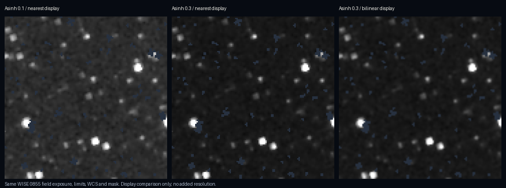

# Browser display processing

Samuel's console pass: GitHub #35, Linear BYT-36. CPython retains FITS reading,
calibration, WCS registration, wavelength compatibility and validity decisions.
The browser maps prepared intensities to display colors, transforms the viewport
and optionally emphasizes detail in a separate visual copy. The scoped extension
is [#49 / BYT-42](enhancement-research.md). An adjusted image is not calibrated
photometry or a discovery.

## Prepared assets

Optional `Frame.raster` describes an allowlisted binary asset with encoding
`float32-le-mask8-v1`, SHA-256 and exact byte count. The manifest grid supplies
width and height. The file contains width * height little-endian Float32 values,
then that many Uint8 validity values (0 invalid, 1 valid). Both planes use
top-left row-major order, matching the PNG. Invalid intensities are transported
as zero with validity 0; valid negative and bright values remain unclipped.
Values retain MJy/sr units but lack propagated resampling uncertainties.

The limit is 2048 by 2048 and five bytes per pixel (20 MiB). A 118-square field is
69,620 bytes. A 512-square field is 1,310,720 bytes. Clients check the limit,
exact size and checksum before interpreting a buffer. PNG-only manifests remain
supported. Cached bundles retain their original source manifest, acquisition
record, PNG and source observations; derived rasters add their own inventory and
the SHA-256 of the preserved aligned FITS used to produce them.

Regenerate the reviewed derived assets using:

```sh
python scripts/prepare-browser-examples.py --aligned-root .cache/pass-targets
```

The input directory contains the already validated aligned FITS outputs from
the five-target probe, not browser images reverse-converted to intensities.

## Rendering experiment



The comparison uses the first WISE 0855 cached exposure and the same pooled
limits, geometry and validity mask. Asinh 0.3 darkens faint background compared
with 0.1. Nearest display sampling keeps individual grid pixels inspectable;
bilinear display sampling softens their boundaries. The third panel tests
screen interpolation, not a different scientific WCS reprojection. Keep the
validated bilinear scientific registration unchanged. No new resolution is
created and no masked source is recovered by contrast changes.

The browser's quiet preset uses asinh 0.3 with the original shared limits;
Original restores the manifest curve (currently 0.1). Every displayed epoch
shares the same settings. Smooth is now the default screen sampling, with Pixels
available beside the image. Both presets disable experimental detail. The
[new comparison and research](enhancement-research.md) records the current choice.
The existing validated examples retain their actual 6-arcminute footprint.
Live searches now allow up to 120 arcminutes, with fewer exposures requested for
large fields. [Native wide fields](hd-fields.md) records the two-exposure real
2-degree check and explains prepared pixels versus native sampling. Do not
relabel the existing cache as a larger field.

Background matching needs independent stationary-source and uncertainty tests.
PSF matching generally softens sharper observations to a common response. Both
remain unimplemented and explicitly disclosed. WebGPU is a future option if
WebGL2/CPU benchmarks establish a useful benefit on these small fields.

## Browser implementation and recovery

WebGL2 uploads Float32 intensities and integer validity textures. The display
shader explicitly performs nearest or validity-weighted bilinear sampling, then
maps shared black/white, asinh/linear, gamma and no-data style to colors. It writes
at viewport times device-pixel-ratio times zoom, bounded to 2160 pixels per side.
An optional native-grid float pass adds a thresholded, capped detail residual;
it skips any two-pixel neighborhood touching an invalid sample. Detail is off by
default and paused in Mark mode. Scientific registration and validity decisions
remain Python. Uploaded textures and unchanged detail results are reused.

The CPU path uses the same formulas in a module Web Worker; OffscreenCanvas transfers
an ImageBitmap when available, otherwise the worker returns RGBA bytes. Canvas
on the main thread remains the final fallback when Workers are unavailable.

The renderer processes one job at a time and retains only the newest queued
display request. Frame resources stay within the current/neighbor/A-B window
of five for small assets and three when any prepared raster exceeds 5 MiB.
The larger-asset window prioritizes the current frame and comparison A/B.
Loading and stale-result guards keep metadata and the shown frame
together. Context loss triggers CPU rendering; selecting CPU explicitly also
works. Missing or corrupt intensity assets preserve the original PNG and show
why interactive intensity controls are unavailable. They do not fabricate data.
The worker uses an explicit module constructor so the static build emits
executable worker code. Acceptance now asserts `CPU worker`, preventing a failed
worker from silently counting as worker support merely because Canvas recovered.
Missing float-render targets use CPU for detail and can still use WebGL2 when
detail is off. Graphics adapter information is shown when the browser provides it.

The first production-export browser check passed in Chromium and Firefox with
the authentic cached WISE field: maximum CPU/GPU byte difference was zero,
forced WebGL context loss recovered, and disabling both WebGL2 and Workers
still rendered through Canvas. These results establish tested compatibility,
not guaranteed acceleration on every device. That historical report predates
the smooth/detail pass and its worker correction. See the
[recorded result](evidence/console/display-report.json).
Current checks and timing are recorded in [enhancement research](enhancement-research.md).

## Native sampling and overview

The readout distinguishes native samples across the requested field, prepared
grid dimensions, and display dimensions. Unknown native sampling stays unknown.
Native Scale approximates one native sample per physical display pixel when the
field is large enough; Fit preserves the complete field. Neither changes FITS
pixels or creates resolution. Zooming reveals a full-field overview with a
viewport rectangle. Clicking recenters, Enter centers the field, and Escape
still exits the expanded viewer. The thumbnail uses the same anonymous CORS
mode as the frame loader, so its cache cannot block later canvas image loads.

Python limits are shared by schemas, retrieval and processing. The contract
exporter generates browser FOV and raster-byte constants from OpenAPI, avoiding
independent numeric limits that drift between the form, URL parser and decoder.
