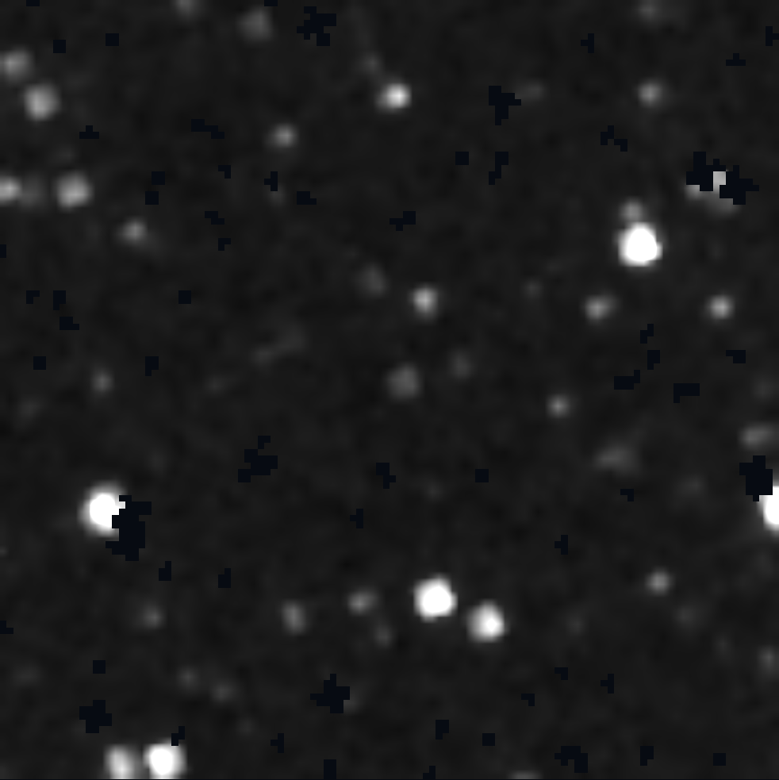
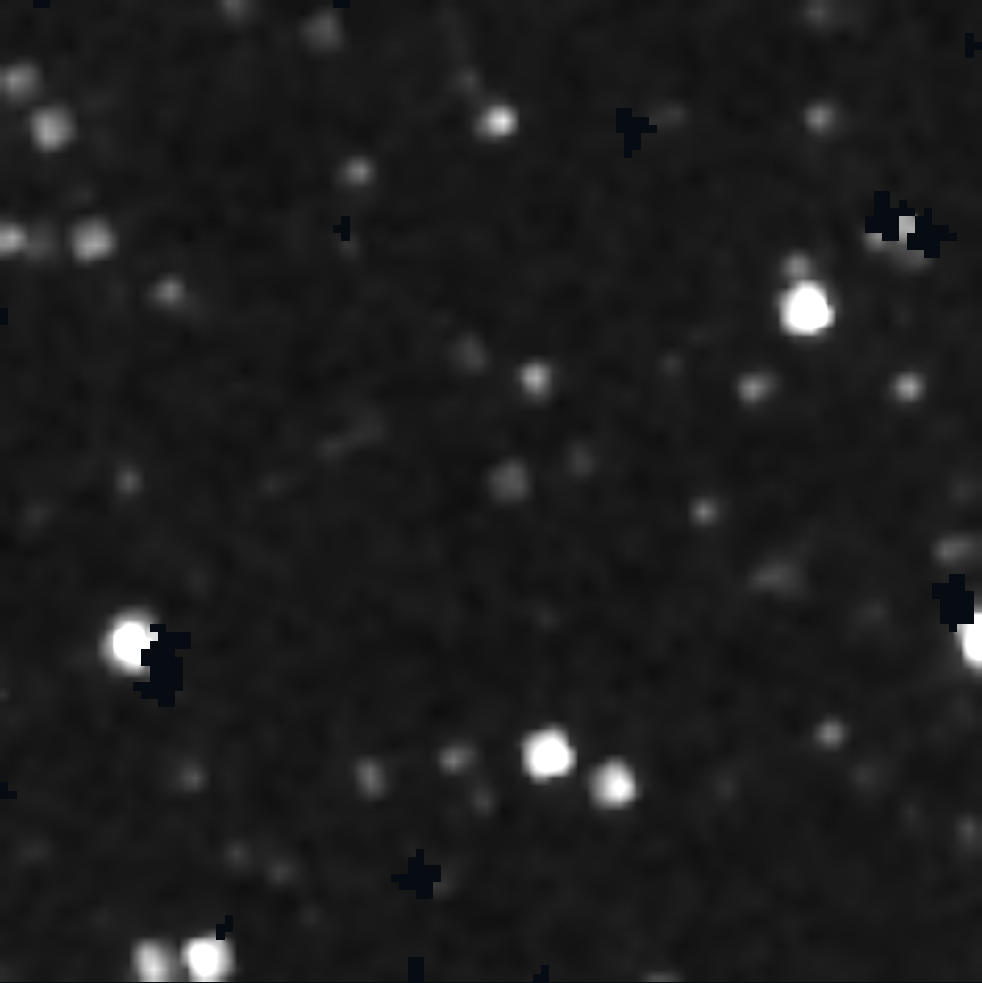
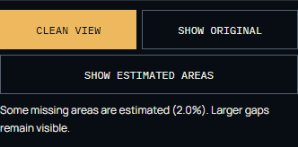

# Clean View: estimated small gaps

GitHub [#66](https://github.com/Sammieblz/khonsu/issues/66), Linear
[BYT-50](https://linear.app/byteboyz/issue/BYT-50). This extends the
[quality-mask pass](image-quality.md) with actual display-only gap filling.

## Try it

With the updated Docker Compose images running, open http://localhost:3000 and
hard-refresh. Load the primary WISE cached real example.

1. **CLEAN VIEW** starts on for a new visitor. Small eligible patches blend into
   the surrounding background. The notice states that some areas are estimated.
2. **SHOW ORIGINAL** toggles the original observation at the same date, zoom and
   stretch. Toggle again to return. It pauses playback for inspection.
3. **SHOW ESTIMATED AREAS** marks only the filled regions with amber stripes.
   This overlay is off initially. Larger holes remain visible in both views.
4. Step through actual dates. Each frame uses only its own neighboring samples.
5. Switch to **MARK**. The original appears automatically, estimates and detail
   pause, and saved marks retain the original strict validity. A mark in a filled
   area remains unavailable or warning-only in its evidence.
6. Turn Clean View off, reload and load the example again. The preference stays
   off. Turn it on to restore the public view. Blocked browser storage does not
   disable the controls.
7. Open **ADVANCED IMAGE DISPLAY** for sampling, detail, masks, stretch, GPU/CPU
   and display resolution. These are optional inspection controls.

The Epsilon Indi backup has a large excluded star core. That core is deliberately
unfilled; a PSF-based reconstruction is outside this change. Old sequences without
an estimate asset continue displaying their originals. If a fill asset fails
verification or loading, the original still loads and the app explains the fallback.

## Method and boundaries

`apps/api/app/processing/gap_fill.py` prepares a separate derivative in CPython.
An eight-connected component groups adjacent rejected pixels. A component must
be enclosed by valid pixels, span at most four native samples, and contain at
most twelve native sample areas. Hard limits are 16 prepared pixels per side,
128 per component, 2,048 components, 65,536 filled pixels and 10% of the frame.
Any boundary pixel brighter than the field median plus five robust sky sigmas
disqualifies the component. Image edges, broad holes and bright star cores stay
unfilled. A native sample is not a screen pixel.

For an eligible component, a deterministic four-neighbor harmonic interpolation
solves the discrete Laplace equation with fixed valid boundary values. Its values
stay within the boundary range, so the fill does not create a new interior peak.
No other observation, random texture, AI model, sharpening or new library is used.
SciPy is already part of the science environment.

This is a conservative alternative to the broader
[biharmonic inpainting example](https://scikit-image.org/docs/stable/auto_examples/filters/plot_inpaint.html).
It does not recover the actual signal hidden by a mask. An unknown faint source
can be absent from the estimate. Appearance can still change when masks change
between dates. Use original observations to investigate apparent motion.

The source PNG, prepared intensity/quality raster, calibrated FITS, observation
dates, WCS, flags, comparison stretch and original masked fraction are unchanged.
No optical resolution, measured coverage, source flux or detection is added.
The browser's GPU or CPU displays the precomputed estimates; it does not solve
the interpolation again during playback. Measured pixels never interpolate
from estimated neighbors.

## Additive API contract and provenance

Each frame may add `gap_fill` and `estimated_fraction`. The original `raster`
retains its existing encoding and exact bytes. An example derivative is:

```json
{
  "gap_fill": {
    "url": "/v1/examples/real-wise-0855/frames/frame-0001-fill.bin",
    "encoding": "float32-le-estimate8-v1",
    "size_bytes": 69620,
    "sha256": "c407014e813f3afb759cef2d31609811f380e69751831b5f1e8bd4037503663e"
  },
  "estimated_fraction": 0.019606434932490664
}
```

This is the first bundled WISE frame's actual derivative. The file contains a top-left
float32 LE estimate plane and a byte mask identifying estimates, with zeros
elsewhere. Its mask never means measured validity. Both rasters have the same
grid and individual 20 MiB bound. The large-frame cache counts their combined
size. Optional estimate requests time out after 15 seconds.

Server validation rejects estimates as observation rasters, overlapping valid
pixels, incompatible grids, unexpected paths, corrupted bytes and inconsistent
fractions. The browser independently verifies bytes, mask, grid, fraction and
overlap. No new endpoint accepts client paths or URLs. Normal asset allowlists
include the derivative referenced by the manifest.

`prepare-clean-examples.py` works offline from the reviewed rasters. Their SHA-256
values, source manifests, acquisition dates and PNGs stay intact. The new lineage
records the input raster checksum, method and output checksum. Live processing
uses the same implementation before publishing its manifest. Evidence retains
the processing policy and original quality; it never treats a fill as a measurement.

## Verification and limits

The [real-image evaluation](evidence/clean-view/science.json) records all five
prepared frames, actual observation IDs, timestamps, checksums and settings.

| Cached field | Originally excluded pixels filled | Accepted holdout error, 95th percentile |
| --- | --- | --- |
| WISE 0855, three frames | 62-87% | 1.29-1.44 robust sky sigmas |
| Epsilon Indi B, two frames | 24-40% | 0.35-0.79 robust sky sigmas |

The evaluation hides 30 separate valid regions per frame, in one-, three- and
five-pixel sizes. It compares only accepted estimates with the hidden measured
values. This control is not ground truth for the archive's real rejected pixels.
The original samples are unchanged. Preparation of these small grids took about
3-10 ms in the recorded Docker environment, excluding downloads and FITS work.
This is not a general device or large-field speed guarantee.

On November 15, 2026, all 134 backend tests and 89 frontend tests passed, along
with contract regeneration checks, TypeScript and the static production build.
The [browser report](evidence/clean-view/browser.json) records 160 CPU/GPU
comparisons in each of Chromium and Firefox with at most one byte of channel
difference. The first WISE frame changes 18,915 displayed pixels and zero
displayed measured pixels when Clean View is enabled. Chromium used SwiftShader
in that parity run; it does not demonstrate hardware GPU acceleration.

Existing [enhancement](evidence/clean-view/enhancement.json),
[candidate](evidence/clean-view/candidates.json),
[quality/4K](evidence/clean-view/quality.json),
[complete viewer](evidence/clean-view/observatory.json) and
[2048-square wide-field](evidence/clean-view/wide-field.json) checks passed in
both browsers. The [accessibility audit](evidence/clean-view/accessibility.json)
passed at 390, 820 and 1440 pixels, including a keyboard-only load, step, mark,
save and export journey with visible focus. Test initialization now waits for
the catalog or restored shared coordinates before interacting with the static
form. This avoids racing React hydration without bypassing form validation.

Compare the same observation and stretch:

| Original | Clean View |
| --- | --- |
|  |  |



Reproduce with the science environment and the existing browser-test setup:

```sh
python scripts/prepare-clean-examples.py
python scripts/validate-clean-view.py
python -m pytest apps/api/tests
python scripts/export-contracts.py --check
npm --prefix apps/web run test
npm --prefix apps/web run typecheck
npm --prefix apps/web run build
node scripts/verify-clean-view.mjs
python scripts/check-repository.py
```

Set `KHONSU_TEST_URL`, `KHONSU_TEST_API`, `PLAYWRIGHT_MODULE` and `AXE_CORE_PATH`
as in [browser acceptance](console-acceptance.md). The dedicated Clean View suite
defaults to isolated ports 3003/8003. It checks changed pixels, unchanged measured
pixels, original comparison, GPU/CPU agreement, real dates, keyboard and mobile
controls, saved preference, candidate validity, failed fill and legacy fallback.
The pointer regression checks that focusing a scrolled canvas does not move the
image between pointer down and the recorded mark.
