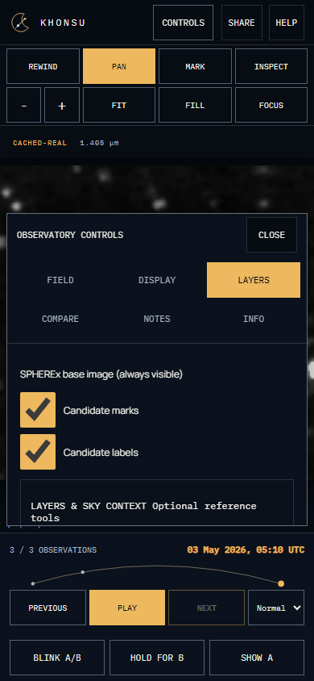

# Dedicated observatory

The frontend design pass is tracked by [#2](https://github.com/Sammieblz/khonsu/issues/2)
and [BYT-14](https://linear.app/byteboyz/issue/BYT-14). It builds on the scientific
image pipeline already integrated through PR #73.

## Console, #61 / BYT-46

`/` introduces the project. `/console/` is a static-exported observatory. The
desktop layout reserves space for a tool rail, image stage, docked inspector
and observation transport. Field, Display, Layers, Compare, Notes and Info tabs
scroll internally. Below 1100 CSS pixels they become a nonmodal bottom sheet;
the time controls remain available. Short screens use document scrolling so
200% zoom does not make controls unreachable.

Fit shows the complete angular field, preserving its aspect ratio. Fill crops
the display to cover the stage and labels the cropped view. Pointer selections,
Gaia positions and overview geometry share the fitted image transform. Neither
mode resamples scientific measurements or changes their WCS.

`ExplorerSession` retains the active sequence, observation, coordinate draft,
selection and unsaved note across client navigation. A bounded `ViewerMemory`
snapshot restores display and comparison preferences for that sequence. The
viewer unmounts on departure, releasing playback timers, image caches and GPU
resources. A running query is cancelled. A page refresh restores URL coordinates
or an explicitly named saved bundle, not an in-memory live job.

- `/console/?example=real-wise-0855` verifies and opens that exact cached bundle.
- `/console/?ra_deg=133.795129&dec_deg=-7.245147&fov_arcmin=6&frame=ICRS`
  fills the form; only Search this field starts an archive job.
- `obs` selects an actual matching observation, when present.
- `embed=1` retains a compact console route.
- Old coordinate links on `/` forward to `/console/` with their query intact.
- Candidate notes never appear in a shared URL.

Base UI 1.9.0 provides keyboard tabs, dialogs, focus return and the mobile sheet.
This adds no runtime Next.js service, second viewer or backend contract.

## Verification

Run the logic tests, type check, static build and repository checks from
[testing.md](testing.md). `scripts/verify-console-design.mjs` exercises real
cached frames, fit/fill, navigation memory, notes/export, responsive controls,
coordinate links and injected unavailable-example/service failures in Chromium
and Firefox. Set `PLAYWRIGHT_MODULE`, `KHONSU_TEST_URL` and optionally `AXE_SCRIPT`
to the local Playwright installation, static preview and axe-core script.

The design suite supplements the scientific renderer tests. It does not establish
new angular resolution, source recovery, live archive availability or public
deployment acceptance. Earlier screenshots in the historical acceptance reports
describe the preceding single-page layout.

November 15 acceptance: 96 frontend tests, TypeScript, static export and repository
checks passed. Chromium 151 and Firefox 153 passed the design journey at 1366x768,
1920x1080, 390x844 and a 683x384 CSS viewport. Axe reported no WCAG 2.1 AA violations
in the loaded console. Both browsers reported no uncaught page errors.

