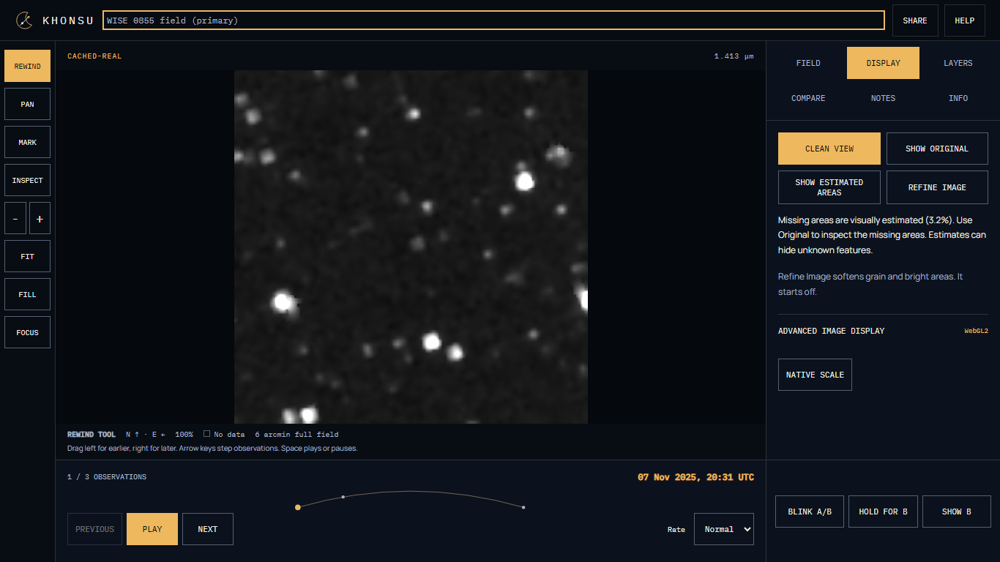
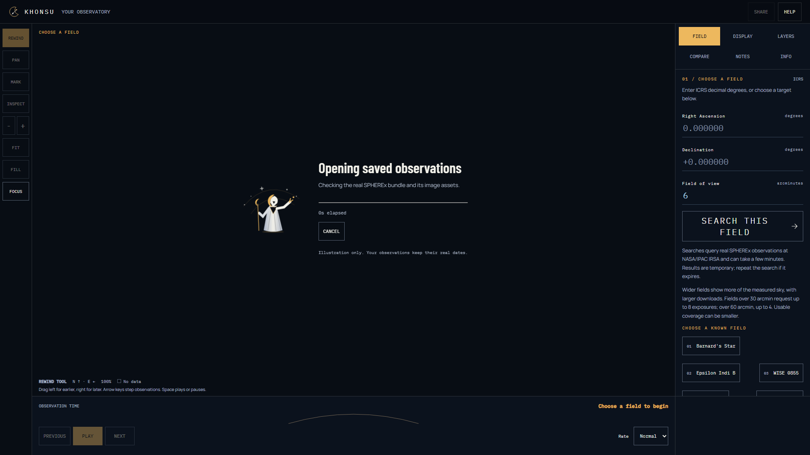
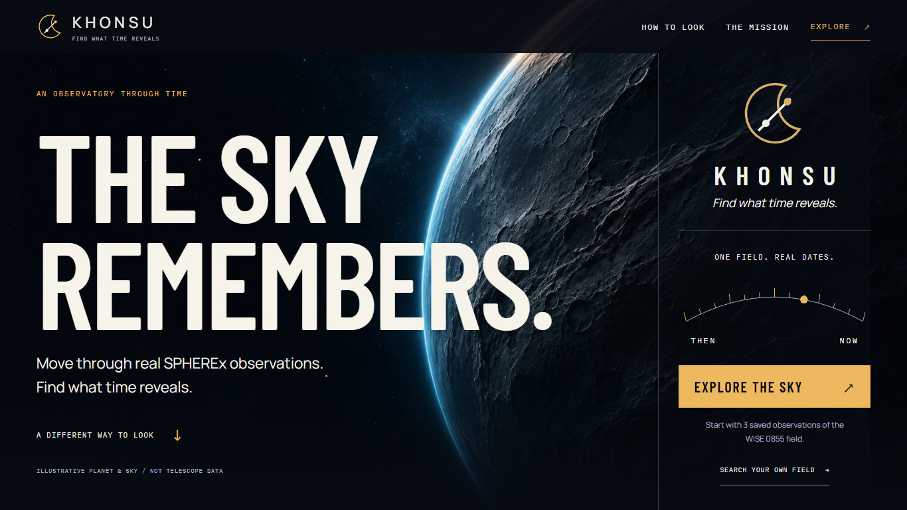
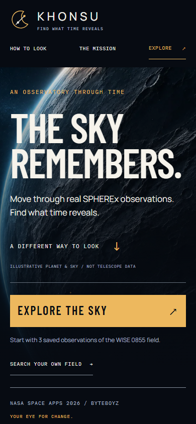

# Dedicated observatory

The frontend design pass is tracked by [#2](https://github.com/Sammieblz/khonsu/issues/2)
and [BYT-14](https://linear.app/byteboyz/issue/BYT-14). It builds on the scientific
image pipeline already integrated through PR #73.

## Console, #61 / BYT-46

`/` introduces the project. `/console/` is a static-exported observatory. The
desktop layout reserves space for a tool rail, image stage, docked inspector
and observation transport. Field, Display, Layers, Compare, Notes and Info tabs
scroll internally. Below 1100 CSS pixels they become a nonmodal bottom sheet;
the time controls remain available. Short screens use document scrolling so
200% zoom does not make controls unreachable.

Fit shows the complete angular field, preserving its aspect ratio. Fill crops
the display to cover the stage and labels the cropped view. Pointer selections,
Gaia positions and overview geometry share the fitted image transform. Neither
mode resamples scientific measurements or changes their WCS.

`ExplorerSession` retains the active sequence, observation, coordinate draft,
selection and unsaved note across client navigation. A bounded `ViewerMemory`
snapshot restores display and comparison preferences for that sequence. The
viewer unmounts on departure, releasing playback timers, image caches and GPU
resources. A running query is cancelled. A page refresh restores URL coordinates
or an explicitly named saved bundle, not an in-memory live job.

- `/console/?example=real-wise-0855` verifies and opens that exact cached bundle.
- `/console/?ra_deg=133.795129&dec_deg=-7.245147&fov_arcmin=6&frame=ICRS`
  fills the form; only Search this field starts an archive job.
- `obs` selects an actual matching observation, when present.
- `embed=1` retains a compact console route.
- Old coordinate links on `/` forward to `/console/` with their query intact.
- Candidate notes never appear in a shared URL.

Base UI 1.9.0 provides keyboard tabs, dialogs, focus return and the mobile sheet.
This adds no runtime Next.js service, second viewer or backend contract.

## Verification

Run the logic tests, type check, static build and repository checks from
[testing.md](testing.md). `scripts/verify-console-design.mjs` exercises real
cached frames, fit/fill, navigation memory, notes/export, responsive controls,
coordinate links and injected unavailable-example/service failures in Chromium
and Firefox. Set `PLAYWRIGHT_MODULE`, `KHONSU_TEST_URL` and optionally `AXE_SCRIPT`
to the local Playwright installation, static preview and axe-core script.

The design suite supplements the scientific renderer tests. It does not establish
new angular resolution, source recovery, live archive availability or public
deployment acceptance. Earlier screenshots in the historical acceptance reports
describe the preceding single-page layout.

November 15 acceptance: 96 frontend tests, TypeScript, static export and repository
checks passed. Chromium 151 and Firefox 153 passed the design journey at 1366x768,
1920x1080, 390x844 and a 683x384 CSS viewport. Axe reported no WCAG 2.1 AA violations
in the loaded console. Both browsers reported no uncaught page errors.

## Entry and feedback, #62 / BYT-47

The #77 follow-up supersedes the original 900 ms policy. Explore starts navigation
immediately, while the original SVG sky sweep runs for three seconds even when
images are ready. Errors, Skip and Escape remove it early. Returning to a loaded
session and reduced motion skip it. The guardian appears only during entry; later
loads use ordinary status feedback. See [guided-notebook.md](guided-notebook.md).
The request is never gated by an animation-completion callback.

The small ivory and amber guardian is original, code-authored SVG artwork. Its
arm gestures and star arc use CSS transform/opacity with the existing easing
tokens. It is decorative and excluded from assistive announcements. No Marvel
frames, character assets, audio or simulation dates are used. The user's
[reference scene](https://www.youtube.com/watch?v=XDk9jjZxx70&t=35s) informed the
gesture, not any celestial observation.

The status model uses actual queued/retrieving/processing job states, then browser
image preparation. The progress bar receives a value only from the server. Saved
bundle checks and image loading remain indeterminate. Elapsed time is outside the
polite stage live region. Cancel, retry and edit actions stay available. Animation
pauses when hidden or outside the viewport, using the
[Page Visibility API](https://developer.mozilla.org/en-US/docs/Web/API/Page_Visibility_API)
and IntersectionObserver. All observers and timers are cleaned up.

`scripts/verify-sky-motion.mjs` records entry/loading video in Chromium and Firefox,
with delayed real cached assets, reduced motion and injected server cancellation.
Chromium runs at 4x CPU throttling. This measures browser behavior on this desktop;
it does not establish weak-GPU or physical-phone performance. The 98 frontend
tests include server-stage and actionable failure tests. Console acceptance remains
green after the loading integration.
The corrected cold-entry timing was 59 ms from click to request in throttled
Chromium and 20 ms in Firefox, both before the intro finished.

The migrated Clean View suite also passes in both browsers, including all real
cached frames, original pixels, gap-fill exclusion from candidate evidence and
GPU/CPU byte agreement. The real Gaia/WISE suite passes: 55 catalog sources in
the bounded result, marker alignment within 0.02 display pixels, successful WISE
tile retrieval, independent injected catalog failure/retry and compact embeds.

## Landing story, #63 / BYT-48

The three chapters explain choosing coordinates, comparing actual dates and
preserving evidence. [The storyboard and asset register](art-direction.md)
record the original planet artwork, guardian and unmodified real previews.
The five fields show dated results from the existing coverage report; R Draconis
retains its timeout outcome. These are historical checks, not promises about a
new query. Live preset coordinates are used when available, with the verified
report as a static fallback.

GSAP 3.15.1 with @gsap/react 2.1.2 owns only the landing scroll progression. At
1100 CSS pixels wide and 700 high, with normal motion, native vertical scrolling
translates the three chapters. The hero has restrained scroll-linked parallax.
MatchMedia cleanup removes transforms and pins when the route or media condition
changes. Mobile, reduced motion, short screens, Simple View and no-JavaScript
keep all chapters in vertical document flow. No observation renderer runs on the
landing page. The mission iframe still loads only when opened.

`verify-landing-design.mjs` passed in Chromium 151 and Firefox 153: horizontal
progression, fallback layouts, 200% CSS viewport, keyboard entry, preset links
without automatic archive jobs, no page errors and zero landing axe WCAG 2.1 AA
violations. The combined console and entry suites pass after GSAP integration.
There are 100 passing frontend logic/lineage tests. Retired hero/workspace CSS,
the old decorative sky asset and unused geometry helpers were removed.

The extended console suite also passes in installed Chrome 157 and Firefox 153:
failed image retry, a single real frame with playback disabled, an injected
no-coverage response, missing cached example and offline service. These injected
transport cases test recovery; they are not new archive coverage measurements.

### Local performance record

The [raw comparison](landing-performance.json) compares static baseline commit
`4655868` with the landing redesign on this desktop, using the same real API
metadata replay and local font fallback. External Google font requests were
blocked for both. These are one sample per configuration, not a statistical
benchmark or a phone/GPU capability claim.

| Browser | Version | Local resources | Load event | Scroll interval p95 | Intervals over 50 ms |
| --- | --- | --- | --- | --- | --- |
| Chromium, 4x CPU | Before | 670,934 B | 1,499 ms | 16.8 ms | 0 |
| Chromium, 4x CPU | After | 918,389 B | 1,546 ms | 16.7 ms | 0 |
| Firefox | Before | 694,938 B | 481 ms | 16.7 ms | 1 |
| Firefox | After | 911,316 B | 231 ms | 16.7 ms | 0 |

The design adds about 247 KB of loaded local resources in the Chromium sample.
Startup has more long tasks (five versus one at 4x CPU), while the sampled scroll
has no intervals above 50 ms. The backdrop itself is about 111 KB. Do not infer
that the new version is faster from the Firefox load sample. Headless WebGL checks
use the browser's available adapter, which may be software rendering. Physical
mobile performance and public-network deployment remain separate checks.

