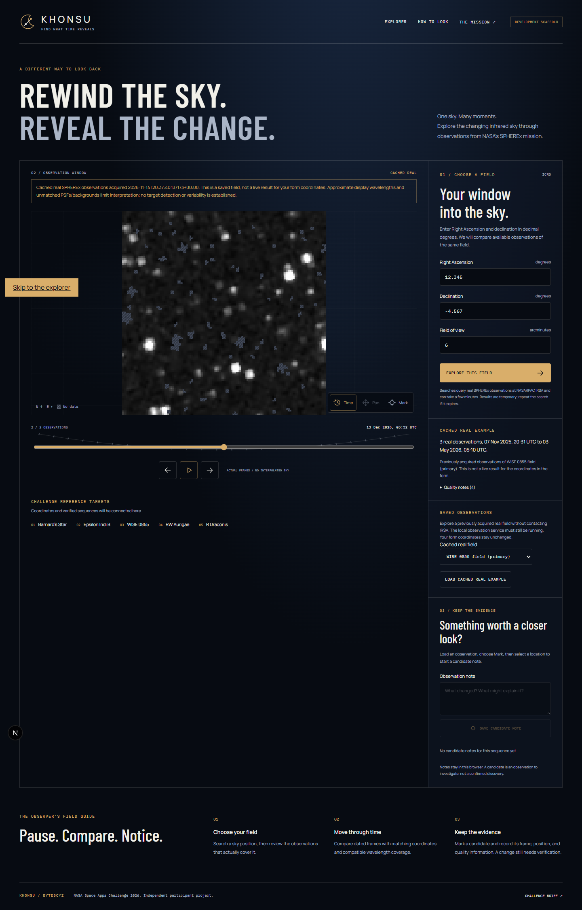
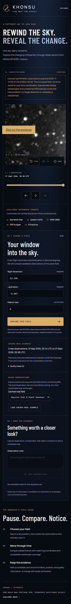

# Coverage and cached-example acceptance

Verified November 14, 2026 for Samuel Ndubuisi's [coverage ticket #8](https://github.com/Sammieblz/khonsu/issues/8) / Linear BYT-20 and [cached-example ticket #9](https://github.com/Sammieblz/khonsu/issues/9) / Linear BYT-21. The integration review accepts those two outcomes. It does not complete [submission ticket #22](https://github.com/Sammieblz/khonsu/issues/22) / Linear BYT-34 or the entire MVP.

## Revisions and checks

The integrated local build is commit [`fbe18a3e6f11b3870d9104b97d256e2caca6d695`](https://github.com/Sammieblz/khonsu/commit/fbe18a3e6f11b3870d9104b97d256e2caca6d695), merging [cached observations PR #33](https://github.com/Sammieblz/khonsu/pull/33). The [five-target coverage PR #32](https://github.com/Sammieblz/khonsu/pull/32) and [demo preparation PR #31](https://github.com/Sammieblz/khonsu/pull/31) were merged first.

API/scientific tests, all 19 frontend tests, TypeScript, the static frontend build, contract consistency and the repository text/link check passed. The five standard [CI jobs for the integrated revision](https://github.com/Sammieblz/khonsu/actions/runs/43640008701) passed. The API log's quiet output did not expose a reliable combined count, so no combined API-test count is asserted here. Both local services were healthy after rebuilding the merged revision.

## Live primary reproduction

A separate fresh-browser run submitted the actual explorer form for the WISE 0855 field: ICRS RA `133.7601213914074`, Dec `-7.242127941212259`, field `6` arcminutes, `max_frames=16`. The sequence reached ready at 38.448 seconds from browser-run start. Frame stepping, rendered-image and mobile-width checks finished at 41.247 seconds with no browser errors. This timing belongs to one observed run, not an archive availability guarantee.

That live run used processing revision `c3316e2814ba317eadc88795f9078042db006128`, before the later packaging integration. Its source-frame and comparison metadata matched the selected primary bundle exactly: observation IDs, start/end UTC, release, detector, approximate wavelengths/bandwidths, mask fractions, grid and display limits. The common grid is 118 x 118, ICRS TAN, north-up/east-left, with the recorded flip-y raster convention. The display pipeline is `khonsu-display-0.3.0`.

| Original exposure start, UTC | Observation ID | Release | Approximate target wavelength, micrometers | Masked field |
| --- | --- | --- | --- | --- |
| 2025-11-07T20:31:27.206400Z | `2025W45_2A_0292_2` | DR1 | 1.413164368794356 | 3.167193% |
| 2025-12-13T05:32:45.657600Z | `2025W50_2A_0479_1` | DR1 | 1.4130097019790342 | 3.016375% |
| 2026-05-03T05:10:37.948800Z | `2026W18_2A_0663_1` | DR1 | 1.404985374104534 | 2.470554% |

All three frames use detector 2. Their wavelength spread is within the processor's one-quarter-of-minimum-bandwidth bound. The bundle's [manifest](../fixtures/real/real-wise-0855/manifest.json), [lineage](../fixtures/real/real-wise-0855/lineage.json), [acquisition record](../fixtures/real/real-wise-0855/acquisition-record.json) and [source manifest](../fixtures/real/real-wise-0855/source-manifest.json) retain the exact source URLs and scientific settings.

The [coverage report](target-coverage.md) accounts for all five required fields. Four bounded samples produced usable field frames. R Draconis recorded an `archive_timeout`, explicitly a failed upstream attempt rather than a claim of absent archive coverage. The selected backup is the Epsilon Indi B field, `real-epsilon-indi-b`, with two comparable DR1/QR3 epochs; its [manifest](../fixtures/real/real-epsilon-indi-b/manifest.json) and provenance remain separate from the primary.

## Cached replay with the archive unavailable

The integration run loaded both `real-wise-0855` and `real-epsilon-indi-b` through the real application with upstream access blocked. The reviewed primary bundle totals 72,119 bytes and the backup 52,309 bytes, 124,428 bytes combined. The backend instrumentation recorded zero attempted outbound requests during cached replay. The local API remained running to serve its bundled assets; this does not establish a backend-free frontend.

For both examples, the explicit selection under **Saved observations** displayed the cached-real label and original epochs, preserved unrelated query inputs (RA `12.345`, Dec `-4.567`, field `6`), and did not display a live-result label. Stepping selected real frames. The 390-pixel viewport had a 390-pixel document width, with no horizontal page overflow or browser errors. A second replay after rebuilding merged commit `fbe18a3` passed the same two-example, label, query-preservation, stepping and mobile-width checks.

These are unmodified acceptance captures. The desktop capture shows the primary's second epoch; the mobile capture shows the backup's second epoch. The phone viewer's toolbar/orientation controls still overlap the image; that unchanged layout limitation belongs to [#18](https://github.com/Sammieblz/khonsu/issues/18). These width checks do not establish full accessibility acceptance.

| Screenshot | Bytes | SHA-256 |
| --- | --- | --- |
| `cached-example-desktop.png` | 680916 | `42ca70690c1757178b91c48ed91153b4da762e81c60076a5f9c71f465371d1ab` |
| `cached-example-mobile.png` | 386936 | `a05f374e69bcdd9aa0ddb831ed1b0657132f5b4b77d82ffef2499ca13edfb452` |

## Missing-asset recovery

An isolated acceptance check removed a bundled frame. The cached API returned HTTP 503 with code `CACHED_EXAMPLE_UNAVAILABLE`. The browser showed: "A bundled cached observation example is missing or corrupt. Restore the reviewed bundle; no substitute data was loaded." No science frame was displayed under a false successful result. Restoring the reviewed asset restored normal cached loading.

The shipped [bundle instructions](../fixtures/real/README.md) describe validation, source attribution, checksums and reconstruction. Synthetic development fixtures remain in their separate directory and are not substituted for either real example.

## Interpretation and remaining gates

These results establish reproducible field playback and an explicit cached fallback. The absence of a `TARGET_MASKED` warning does not establish recovery or detection of WISE 0855 or Epsilon Indi B, apparent motion, variability, a resolved binary, or Planet X. Approximate display wavelengths, unmatched PSFs/backgrounds and unpropagated resampling uncertainty remain disclosed.

No final video, public hosted route, full candidate sky-coordinate/evidence export, complete accessibility acceptance, or portal receipt was produced by these tests. Those remain gates in the [submission handoff](submission.md). The [demo runbook](demo.md) records which rehearsal checks are complete without closing #22.
