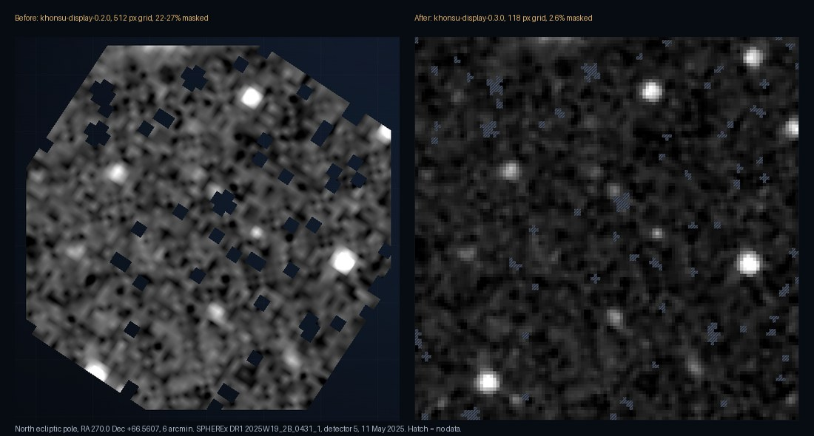

# Display rendering

How the processor turns SPHEREx cutouts into the frames the viewer shows, and what the viewer may and may not do with them. Display pipeline `khonsu-display-0.4.0` (#60 / BYT-45). The rules in [scientific integrity](science-integrity.md) still apply.

## What the image can show

A SPHEREx pixel covers about 6.15 arcseconds. A 6 arcminute field is about 58 native pixels across, from one exposure. Enlarging the display does not add measured resolution. The scientific products use no upscaling model, sharpening, super-resolution, inpainting, stacking of epochs or interpolated epochs. The separately labelled [browser detail experiment](enhancement-research.md) modifies a visual copy only; it is not a new science product. Pan and zoom ([viewer interactions](viewer-interactions.md)) are the way to look closer.

## Cutout

The retriever requests a square cutout 1.5 times the field width. IRSA aligns cutouts to the detector, which is rotated on the sky. Any rotation of a square fits inside one about 1.41 times wider. The requested field may be up to 120 arcminutes and its padded cutout up to 180 arcminutes; detector edges and masks can still leave gaps. Individual FITS downloads are bounded to 64 MiB and all downloads for one job to 256 MiB. The frontend requests fewer exposures for wide fields. Most bytes in small cutouts are fixed-size extensions: a 9 arcminute cutout of the north ecliptic pole was 4,066,560 bytes, the same as a 6 arcminute one.

## Grid and resampling

The default grid samples the field at half the native pixel scale, read from the inputs' WCS (`GRID_OVERSAMPLE = 2`), capped at 2048 pixels. A 6 arcminute field remains 118 x 118 pixels of about 3 arcseconds. A 60 arcminute field is about 1171 pixels and a 120 arcminute field reaches the 2048 cap, depending on the measured native scale. The previous 25,165,824 total output-pixel budget is retained: larger frames mean fewer frames, and excessive requests fail explicitly. Earlier pipelines used a fixed 512 grid, then a 512 cap, which either oversampled narrow fields or discarded sampling on wide ones. See [the real wide-field verification](hd-fields.md).

Each frame is resampled onto the common ICRS TAN grid with validity-weighted bilinear interpolation. The image (masked pixels set to zero) and the validity weights are interpolated separately and divided, so every value is an average of valid neighbouring pixels only. A grid pixel is valid only when its nearest source pixel is valid and inside coverage. Masked areas therefore keep their true size and position, and no value is created for them.

Plain bilinear interpolation over masked (NaN) pixels, used before, turned every grid pixel touching a masked pixel into a hole. In a synthetic control with five masked pixels it masked 13 grid pixels; the current method masks exactly the five.

## Quality flags

Flag names come from each file's `MSKNnnnn` cards. Meanings below are IRSA's short descriptions from the [Spectrophotometry Tool flag notes](https://irsa.ipac.caltech.edu/onlinehelp/spherex/spherex/sp.html); the full definitions are in Table 16 of the [SPHEREx Explanatory Supplement](https://irsa.ipac.caltech.edu/data/SPHEREx/docs/SPHEREx_Expsupp.pdf).

| Treatment | Flags | Reason |
| --- | --- | --- |
| Masked | TRANSIENT (e.g. cosmic-ray hit), OVERFLOW (nearing saturation), SUR_ERROR (possible errors), NONFUNC (dead pixel), DICHROIC (unusable pixel), MISSING_DATA (no data), HOT (noisy pixel), COLD (unresponsive pixel), NONLINEAR (cannot be corrected), PERSIST (persistent charge), CROSSTALK, GHOST, GHOST_FPA, GHOST_EXT, STREAK, BLOOM, SNOWBALL, HALO, SATELLITE_HALO | The list IRSA's [source discovery tutorial](https://caltech-ipac.github.io/irsa-tutorials/spherex-source-discovery-tool-demo/) excludes, which sets the conservative CONTAINS_BAD_PIXEL warning. IRSA gives no short definition for the flags without one here. |
| Masked, conservative | OUTLIER (flagged outlier), PHANMISS (cannot be corrected) | Not in IRSA's list. Kept masked because an unexplained outlier pixel can look like change between epochs. Open for science review. |
| Kept | SOURCE (known source), FULLSAMPLE (full history available) | Describe the pixel; they do not mark bad data. |
| Masked | Any bit without an `MSKN` name | Undocumented, so excluded conservatively. |

On the north ecliptic pole test frames (detector 5, about 3.92 micrometres), flags mask 2.55% and 4.28% of native pixels. The largest single causes are OUTLIER (1.29% and 1.76%) and HALO (0.73% and 2.05%). SOURCE marks about 35% of pixels and is kept.

## Stretch

One display range applies to every frame in a comparison, so a constant source cannot appear to vary because of scaling. It is anchored on the empty sky across all frames' valid pixels: the median and a robust sigma (1.4826 times the median absolute deviation).

- Black: sky median minus 2 sigma, so empty sky renders dark rather than as mid-gray static.
- White: the 99.5th percentile, but never closer than sky plus 50 sigma, so a starless field is not stretched until its noise looks like structure.
- Curve: asinh with a = 0.1 between those limits.

The manifest's `display.vmin`, `display.vmax` and `processing` fields record the limits and parameters. Calibrated values are kept in each frame's FITS grid; never measure from the PNG.

## No-data display

Masked and uncovered pixels are transparent in each PNG. The current viewer fills them with slate `#273140`, optionally with detailed hatch lines `#465263`, and shows a "No data" key beside the orientation marks. They never show the page background. The same style applies in every frame, so a mask that changes between epochs stays visible during stepping or blink.

The viewer now offers Smooth and Pixels modes and renders at the bounded display
size. Smooth interpolates valid intensities before the display stretch; the
nearest source validity still decides the mask. Pixels selects nearest samples
for inspecting the prepared grid. This replaces the former integer canvas
enlargement and mandatory CSS pixelation. See [browser display](browser-display.md).

## Verification

North ecliptic pole field, RA 270.0, Dec +66.5607, 6 arcminutes; DR1 exposures `2025W19_2B_0431_1` and `2026W06_1A_0327_1`, detector 5.

| Pipeline | Masked grid pixels |
| --- | --- |
| 0.2.0, field-width cutout (app run for PR #27) | 22.0% and 27.3% |
| 0.2.0, 1.5x cutout (offline replay) | 8.6% and 12.7% |
| 0.3.0, live app run on November 14, 2026 | 2.58% and 4.25% |

The live 0.3.0 run used the Docker stack and the real explorer form in headless Edge. The 16-frame search was ready after 210 seconds, inside the 240-second job budget, with a 118 x 118 grid at 3.05 arcseconds per pixel (native 6.145 arcseconds).

Both 0.3.0 frames were cross-correlated with the unWISE W1 (3.4 micrometre) image of the same field, from the Legacy Survey [FITS cutout service](https://www.legacysurvey.org/viewer/fits-cutout?ra=270.0&dec=66.5607&layer=unwise-neo7&pixscale=2.75&size=131&bands=1) and resampled onto the same grid. The best match is at zero offset for both, with correlations of 0.94 and 0.92, so sources line up to within one 3 arcsecond grid pixel.

## Limits

Point-spread functions and backgrounds are not matched, resampling uncertainty is not propagated, and the bilinear average of valid neighbours slightly smooths noise. Bright stars can still be masked by NONLINEAR, OVERFLOW or BLOOM. The display wavelength remains approximate. These frames support visual comparison, not measurement.
