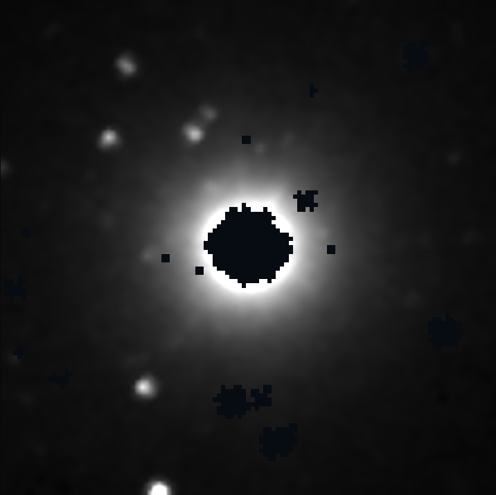
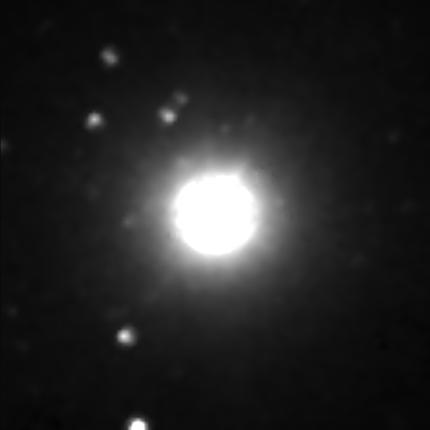
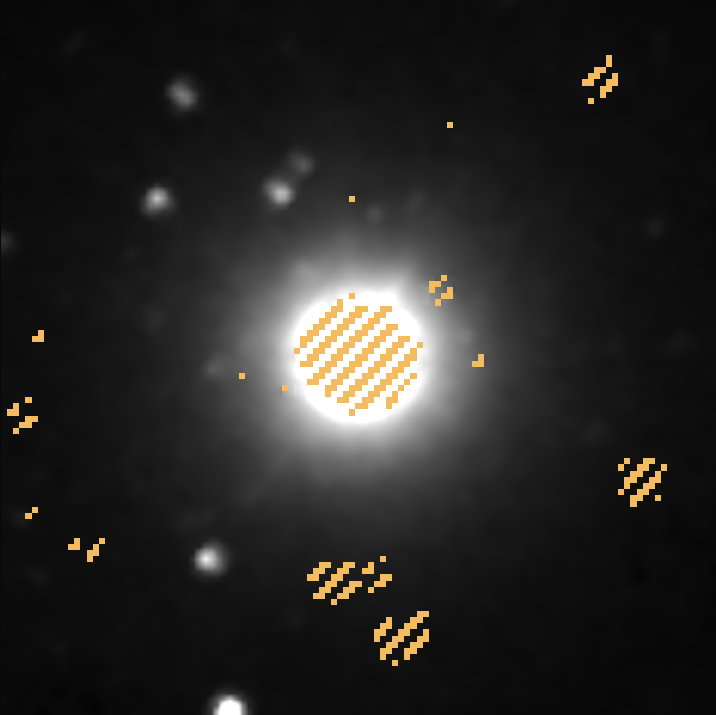

# Filling the masked Draconis core for display

GitHub [#89](https://github.com/Sammieblz/khonsu/issues/89), Linear
[BYT-58](https://linear.app/byteboyz/issue/BYT-58), owned by Samuel Ndubuisi.

## What was wrong

The user's live six-arcminute R Draconis field contained two masked central
components of 269 and 245 prepared pixels, spanning 20 by 21 and 20 by 22 pixels.
Clean View v2 allowed only 128 pixels and 16 pixels of span. Smaller gaps already
filled, but the large dark centre was rejected by these implementation limits.
Both source manifests report `TARGET_MASKED`; these images cannot establish a
measurement of the target's actual core brightness.

The [preserved inputs](../fixtures/validation/r-draconis-gap/README.md) record
the original rasters, hashes, WCS, shared stretch and source FITS cutout URLs.
They are genuine SPHEREx observations, not simulated stars:

| Observation | Release and actual UTC start | Central missing pixels |
| --- | --- | --- |
| `2025W29_2A_0288_3` | DR1, 2025-07-18 16:04:04.972800 | 269 |
| `2026W29_1A_0015_3` | QR3, 2026-07-13 01:43:29.913600 | 245 |

## Result and controls

Clean View v3 fills these holes using their own surrounding valid samples. All
557 and 538 excluded pixels in the two reviewed frames receive separate visual
estimates. Original values and masks are unchanged. This improves appearance;
it does not recover missing light, the true stellar peak or target photometry.

| Original | Clean View |
| --- | --- |
|  |  |



To test after updating:

1. Refresh the app and run a new search for **R Draconis**, field of view 6 arcmin.
   An image already open in a tab retains its old prepared assets.
2. Open **DISPLAY**, enable **CLEAN VIEW** and leave **SHOW ORIGINAL** off.
3. Use **SHOW ORIGINAL** to restore the holes or **SHOW ESTIMATED AREAS** to reveal
   the fills in amber. The image footer says **Filled gaps are estimates**, even
   with the inspector closed.
4. Step through both real dates. Each uses its own neighbours, not another date.
5. **MARK** shows the original automatically. A note in the filled core still
   exports `pixel_has_data: false` and cannot claim a measured target.

## Method and limits

The same four-neighbour Laplace equation is used. For components exceeding the
old limits, the region must be entirely interior, span at most 12 native samples
and contain at most 96 native sample areas. Absolute caps are 32 prepared pixels
of span and 512 pixels of area. Its area must occupy at least one quarter of its
bounding rectangle, excluding long thin coverage chains. Small edge notches keep
the old limits. The existing 10% frame, 65,536-pixel and 2,048-component budgets
remain in force. Broad gaps can still remain unfilled.

Larger components use SciPy's existing
[sparse linear solver](https://docs.scipy.org/doc/scipy/reference/generated/scipy.sparse.linalg.spsolve.html)
instead of a dense matrix. The matrix has at most five coefficients per row.
Small components retain their previous numerical path. Every solution is clamped
to the observed boundary range and cannot introduce a brighter interior peak.
This can flatten a real peak or conceal an unknown source. No PSF fit, extra
epoch, model, dependency or public schema was added.

Live manifests record `bounded-gap-harmonic-v3` and pipeline
`khonsu-display-0.9.0`. Original PNGs, intensity/quality arrays, WCS, timestamps,
wavelengths, warnings and evidence validity remain untouched. Existing bundled
WISE and Epsilon examples retain their reviewed v2 derivatives and lineage.
SPHEREx provides original image and quality planes as described in the
[archive product guide](https://caltech-ipac.github.io/spherex-archive-documentation/spherex-data-products/).

## Verification and reproduction

The [science report](evidence/draconis-fill/science.json) records boundary ranges,
hashes and 16 holdouts of 289 measured pixels each. Their 95th-percentile errors
range from 0.75 to 12.15 robust sky-scatter units. Those errors demonstrate why
visual fills cannot support photometry. Holdouts elsewhere in the image do not
reveal truth inside the real masked cores. Preparation took about 12 to 17 ms
per reviewed frame on the local test machine, not a universal timing guarantee.

The [browser report](evidence/draconis-fill/browser.json) replays these exact real
inputs through the actual console in Chrome and Firefox. It checks changed
appearance, unchanged measured display pixels, CPU/GPU agreement within one
channel byte, Original, estimated-area stripes, disclosure, Mark and evidence
export. This replay is separate from a fresh production archive query.

```sh
python scripts/validate-draconis-fill.py
python -m pytest apps/api/tests -q
python scripts/export-contracts.py --check
node scripts/verify-draconis-fill.mjs
```

Use the browser setup in [testing.md](testing.md); `KHONSU_TEST_URL` selects the
app, `PLAYWRIGHT_MODULE` the installed package, and `CHROMIUM_EXECUTABLE` the
Chrome path. The validator writes its derivatives to `.cache/draconis-fill/evaluation`.
The browser suite reads those files and isolates notes from the production DB.
