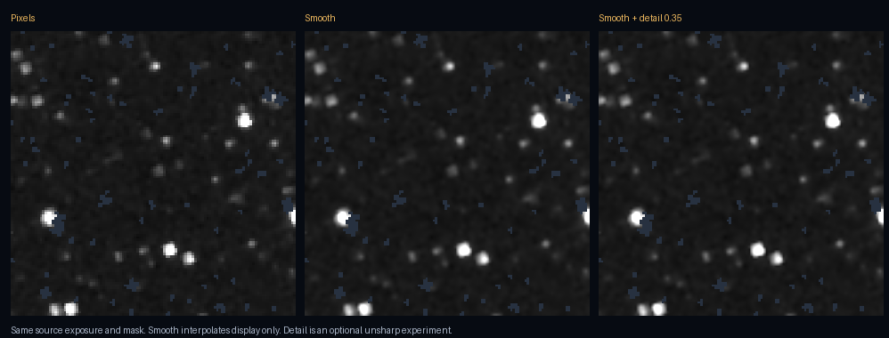
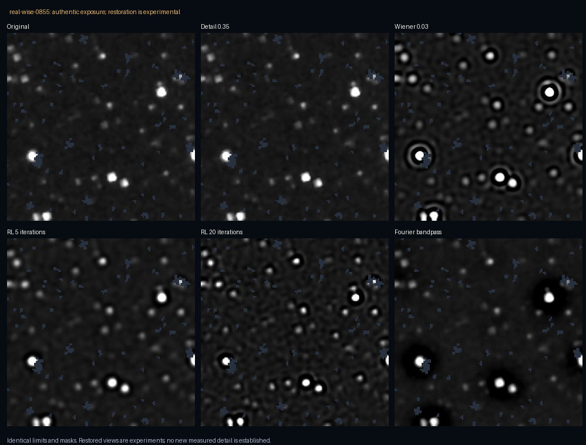

# Display enhancement and PSF restoration experiment

November 14, 2026 local / November 15 UTC. Samuel Ndubuisi, [GitHub #49](https://github.com/Sammieblz/khonsu/issues/49), [Linear BYT-42](https://linear.app/byteboyz/issue/BYT-42).

Smooth display and an optional bounded detail adjustment now run in the Khonsu
console. The stronger restoration methods below remain offline experiments.
They improved some controlled synthetic results but changed apparent positions
and produced artifacts in the tested authentic fields. None of this establishes
new measured resolution, a detection, calibrated photometry or true motion.



## Research and method choices

The user's [MathWorks overview](https://www.mathworks.com/discovery/image-enhancement.html)
is a useful starting point. Deconvolution models an observation as a blurred
scene plus noise: `y = H x + n`. Knowing the blur and noise matters more than
adding iterations or using a faster processor.

| Method | What it does | Decision for Khonsu |
| --- | --- | --- |
| Wiener / Wiener-Hunt | Inverts the PSF in Fourier space with noise suppression or a regularizer | Implemented in the Python experiment. Fast, but the tested real fields show ringing and shifted centroids. Needs a validated forward/noise model before a viewer default. |
| Richardson-Lucy | Iteratively estimates a nonnegative scene using the PSF and a Poisson likelihood | Implemented for research at 2, 5, 10 and 20 iterations. Signed calibrated MJy/sr values with correlated resampling errors are not raw Poisson counts. More iterations can amplify noise. |
| Blind deconvolution | Estimates both the scene and PSF, with constraints and a starting PSF | Researched, not implemented or benchmarked. Mission ePSFs are available; fitting an unknown PSF to these small masked fields introduces another ambiguity. |
| Fourier band-pass | Suppresses broad backgrounds and high frequencies outside a selected band | Implemented offline. Alters extended astronomical signal and can create halos. Not a general blur correction. |
| Fourier notch | Removes a specific periodic contaminant in the frequency spectrum | Demonstrated only on a known synthetic sinusoid. No corresponding periodic contaminant has been identified in the real examples. |
| Thresholded detail | Adds a small, capped high-frequency residual to a display copy | Optional browser experiment, off by default. This is unsharp display emphasis, not PSF deconvolution. |

[MathWorks Wiener documentation](https://www.mathworks.com/help/images/ref/deconvwnr.html)
describes the PSF and noise-to-signal inputs and edge ringing. Our implemented
variant is Wiener-Hunt, using the Laplacian regularizer described by
[scikit-image](https://scikit-image.org/docs/stable/api/skimage.restoration.html):
`X = conjugate(H) Y / (abs(H)^2 + lambda abs(D)^2)`.
Its `lambda` is a regularization weight, not a measured noise-to-signal ratio.

[Richardson-Lucy guidance](https://www.mathworks.com/help/images/deblur-with-the-lucy-richardson-algorithm.html)
explains iteration, damping, weights and noise considerations.
Our masked experimental update uses
`x_next = x * H_transpose(mask * y / H(x)) / H_transpose(mask)`.
A positive offset allows the exploratory update on signed intensities but does
not supply the correct likelihood. Reflected edges and a flipped kernel are a
local convolution approximation, not an exact full detector forward/adjoint
pair. The [blind restoration reference](https://www.mathworks.com/help/images/ref/deconvblind.html)
also requires choices about PSF constraints, damping and included pixels.

## Use the mission's effective PSF correctly

The [IRSA ePSF tutorial](https://caltech-ipac.github.io/irsa-tutorials/spherex-psf/)
documents the DR1/QR3 `EPSF` table and selection by detector position. The ePSF
already includes the pixel response. Integrating it over a pixel again would
broaden the model incorrectly. Old QR2 optical PSF assumptions do not apply to
these files. See also [archive product documentation](https://caltech-ipac.github.io/spherex-archive-documentation/spherex-data-access/).

The experiment reads the exact FITS sources listed by the cached manifests.
It maps the requested coordinate to the parent detector, selects the nearest
calibration zone, evaluates the oversampled pixel response at native centers,
and projects that response to the existing common WCS. The resulting local
21-by-21 kernel includes an approximation to the sampling/reprojection blur.
Its zone, wavelength, sampling, source URL/hash and any clipped negative PSF
mass are recorded in [psf-kernels.json](evidence/enhancement/psf-kernels.json).

This local kernel is assumed shift-invariant for the experiment. It does not
describe every pixel phase, position or wavelength in the field. Its selection
at the requested coordinate is not a confirmation that the named target was
detected. A validated restoration needs a fuller forward model and uncertainties.

## Reproducible experiment

[experiment-enhancement.py](../scripts/experiment-enhancement.py) compares the
first exposure of each authentic cached field, and separately a synthetic image
with known star positions, a known convolution, additive Gaussian noise and
test masks. Random seed is 49. The data and synthetic tests are never blended
into a purported observation. The script records source raster hashes, real
UTC/release identifiers, its own hash, dependency versions and parameters in
[experiment.json](evidence/enhancement/experiment.json).

| Authentic field | Exposure | UTC | Release |
| --- | --- | --- | --- |
| WISE 0855 field | 2025W45_2A_0292_2 | 2025-11-07 20:31:27.206400 | DR1 |
| Epsilon Indi B field | 2025W19_1B_0344_3 | 2025-05-07 05:14:15.590400 | DR1 |

Wiener weights are 0.003, 0.03, 0.3 and 3.0. RL uses 2, 5, 10 and 20
iterations. FFT methods reflect-pad by 24 pixels; invalid input residuals are
set to zero relative to the valid-pixel median only for the auxiliary FFT.
Displayed invalid pixels stay masked. There is no gap filling in the product.
The band-pass uses Gaussian frequency scales 0.025 and 0.30 cycles/grid pixel.

On each real image, one fixed original sky region is reused for all methods.
Its standard deviation ratio is an artifact/change diagnostic: redistributed
star wings and backgrounds contribute, so it is not an isolated noise estimate.
Centroids use positive weights above each patch's median around isolated bright
peaks away from edges and masks. There are 15 such peaks in the WISE field and
14 in the Epsilon field. These are not precise astrometric error estimates.

| Treatment | WISE sky std ratio | WISE maximum centroid change, grid px | Epsilon sky std ratio | Epsilon maximum centroid change, grid px |
| --- | --- | --- | --- | --- |
| Original | 1.000 | 0 | 1.000 | 0 |
| Detail 0.35 | 1.002 | 0.034 | 0.998 | 0.046 |
| Wiener-Hunt 0.03 | 5.162 | 0.779 | 2.628 | 0.437 |
| RL 5 | 1.751 | 0.334 | 1.146 | 0.264 |
| RL 20 | 3.075 | 0.767 | 1.380 | 0.470 |
| Fourier band-pass | 4.074 | 0.967 | 2.328 | 0.998 |



The [Epsilon comparison](evidence/enhancement/real-epsilon-indi-b-methods.png)
provides a second field. Stronger Wiener regularization reduced some changes
but did not establish a validated setting; the full sweep is in the JSON.
The result is a reason to keep these implementations experimental, not a claim
that deconvolution is intrinsically unsuitable for astronomy.

In the synthetic control, original truth RMSE was 0.024697, Wiener 0.03 gave
0.020012, RL 5 gave 0.019485 and RL 10 gave 0.018010. At RL 20 it rose to
0.018641 and blank-region RMS rose to 0.014191 versus the original 0.012244.
Detail 0.35 gave 0.024409. See the [synthetic comparison](evidence/enhancement/synthetic-methods.png).
There is no ground-truth real sky image here to support the same error claim.

The known eight-pixel sinusoid test reduced error to the uncontaminated noisy
image from 0.031820 to 0.000686 with symmetric Gaussian notches of width 0.004
cycles/pixel. That controlled result does not justify choosing a notch frequency
for the authentic fields.

Run in the normal science environment with the existing science requirements:

```sh
python scripts/experiment-enhancement.py --download
python -m pytest apps/api/tests/test_enhancement_experiment.py -q
```

The optional download reads only the two manifest-listed FITS cutouts, at most
16 MiB each. Later runs reuse `.cache/enhancement/` and can run without a network.
Figures and metrics go to `docs/evidence/enhancement/`; input files are not committed.
The analytic tests check asymmetric PSF origin/orientation, masked constant fields,
known synthetic blur improvement, correction bounds and input preservation.

## What runs in the browser

1. **Smooth** interpolates valid prepared intensities before stretch. The nearest
   original validity sample still decides whether an output pixel is missing.
   **Pixels** uses nearest samples. Both retain the original coordinates and FOV.
2. Render directly at viewport size times device pixel ratio and zoom, bounded
   to 1536 pixels on the longest side. This replaces integer enlargement of a
   small intermediate canvas. It changes screen sampling, not measured resolution.
3. **Detail experiment** uses a 5-by-5 separable binomial kernel on a derived
   native-grid copy. Let `r = image - blur(image)` and `s = white - black`.
   The correction is `amount * clamp(sign(r) * max(abs(r) - 0.025*s, 0), -0.08*s, 0.08*s)`.
   Amount defaults to 0; enabling it selects 0.35, with a hard maximum of 0.5.
   No correction is applied within the two-pixel neighborhood of missing data.
   The threshold is a display heuristic, not a measured per-pixel noise model.
4. WebGL2 performs the optional native-grid pass into a float texture and then
   the display pass. Source uploads and unchanged detail results are reused.
   No FITS or authoritative scientific calculation moves into JavaScript.
5. A module Worker runs matching CPU formulas if WebGL2 or float targets are
   unavailable. Main-thread Canvas is the last fallback when Workers fail or
   are unavailable. The status reports the actual path, and adapter information
   appears under Image display when available. WebGL2 alone is not proof of a
   physical GPU; browsers can use software graphics implementations.

The source arrays, cached science products, WCS, epochs and metadata are untouched.
The display settings apply to every selected frame. They do not match the PSFs
between epochs. Inspect apparent variability against the original view.

## Try it and check it

1. Open Khonsu, select a cached real field and load it. Smooth is selected;
   Detail is off. Switch Pixels/Smooth to inspect the enlargement difference.
2. Enable Detail experiment. Hold Original with pointer or Space/Enter to
   compare the same observation without detail. Release, cancel or blur restores
   the setting. Stretch and sampling stay fixed during this comparison.
3. Step, rewind or blink observations. Dates remain real and detail settings
   stay shared. Mark pauses detail automatically; returning to Rewind restores it.
4. Open Image display to adjust Detail amount, view the graphics adapter or
   force CPU rendering. Original/reset disables detail and restores manifest levels.
5. Zoom, pan, mark a known pixel and fit again. Check at desktop and 390px width.
   A corrupt prepared raster should show the original PNG with intensity controls
   disabled. No-data regions must remain visible in every mode.

Run `node scripts/verify-enhancement.mjs` and `node scripts/verify-observatory.mjs`
against a static export with the local API. They use the Playwright setup in
[console acceptance](console-acceptance.md), with no application dependency added.
The enhancement suite compares all five authentic cached frames in both sampling
modes at detail 0, 0.35 and 0.5, checks a signed rectangular ramp, verifies the
production worker, and exercises missing float targets and no-GPU/no-worker recovery.
It also tests original hold, reset, shared settings, Mark, DPR and narrow layout.

Timing includes rendering, a 2D copy and synchronous readback after warmup, using
12 samples per case. It excludes downloads and science processing. Browser
timer precision, headless operation and the specific hardware limit generalization.
The committed browser results and screenshots accompany this experiment.

## Next scientific step

Before shipping PSF restoration, build and validate a detector-space forward
model using the matching ePSF zones and wavelength for each exposure, masks,
calibration variance and resampling operator. Tune regularization on injected
sources across brightness, pixel phase and PSF mismatch; test flux, centroid,
false-feature and uncertainty behavior. A damped or regularized restoration
could then be offered as a separate derived view. Blind fitting and automatic
notches need their own evidence. GPU speed cannot establish these assumptions.
