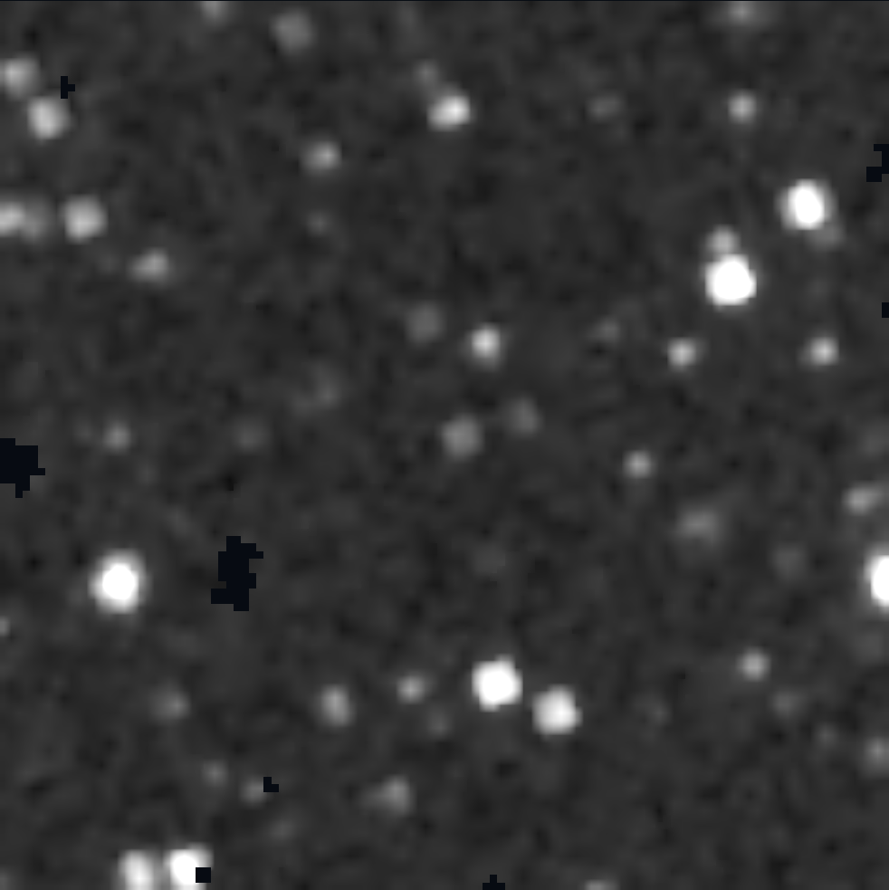
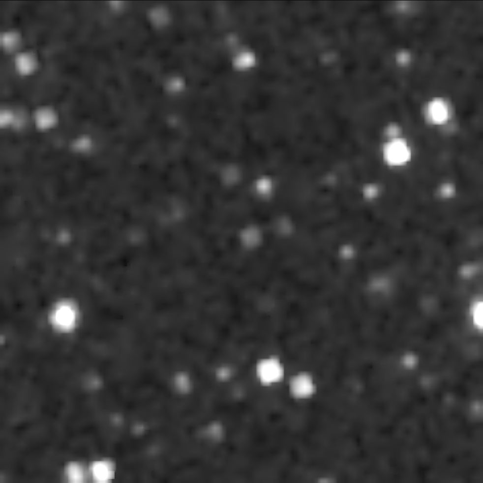
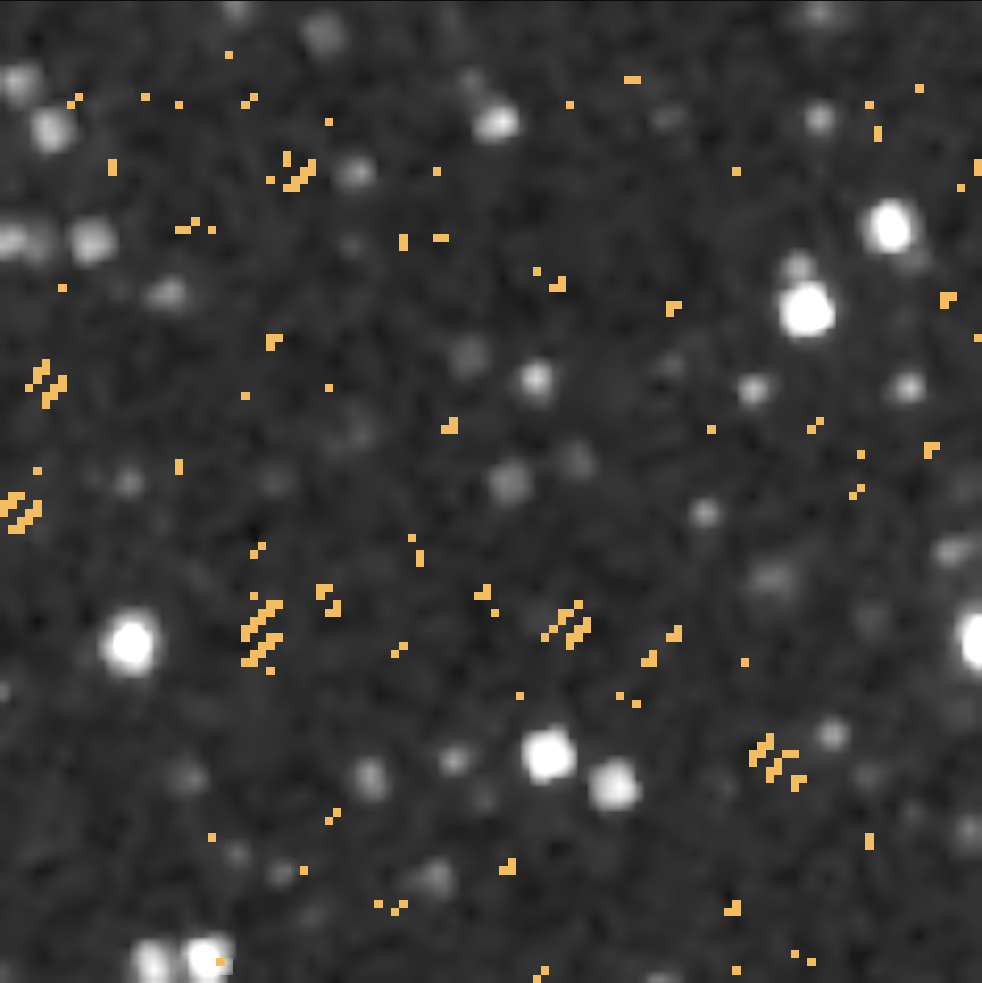

# Completing bounded display patches

GitHub [#70](https://github.com/Sammieblz/khonsu/issues/70), Linear
[BYT-52](https://linear.app/byteboyz/issue/BYT-52), owned by Samuel. This fixes
the remaining patches reported after astro refinement, using the existing
**CLEAN VIEW** control and separate estimate asset.

## Cause and result

The screenshot matches the second cached WISE 0855 observation. Its prominent
interior hole spans 7 by 10 prepared pixels and contains 41 excluded pixels.
Version 1 rejected it because the span limit at that sampling was eight pixels.
The 30-pixel notch at the left was rejected for touching the image boundary.
Other small patches were rejected when any neighboring pixel was bright.
These were implementation restrictions, not a GPU or download failure.

Version 2 fills all excluded components in the five reviewed cached frames.
This means every excluded pixel has a separate display estimate; measured
coverage has not increased. Broad gaps can still exceed the bounded policy.

| Same WISE observation, old Clean View | Revised Clean View |
| --- | --- |
|  |  |

Both images use the same real frame, HD display budget, gamma 1.8, asinh softness
0.3, and grain refinement off. Changing Clean View affects no measured sample.



To test the updated Docker app at http://localhost:3000:

1. Hard-refresh, load the WISE 0855 cached example and step to observation 2.
2. Use **REWIND** or **PAN**, keep **CLEAN VIEW** on, and leave **SHOW ORIGINAL** off.
3. The large interior patch and edge notches should now be filled. Toggle Clean
   View to compare this change alone. Refine Image remains a separate control.
4. **SHOW ESTIMATED AREAS** reveals the fills in amber. **SHOW ORIGINAL** restores
   the excluded patches; **MARK** also uses the original automatically.
5. Repeat with the other observations and Epsilon Indi B. The notice accurately
   distinguishes a completely estimated frame from one with unfilled gaps.

## Bounded visual method

`gap_fill.py` still solves the same four-neighbor discrete harmonic equation in
CPython. Eight-connected grouping keeps diagonally joined missing regions
together. The new native limits are eight samples of span and 32 sample areas,
with unchanged hard limits of 16 prepared pixels per side, 128 per component,
2,048 components, 65,536 pixels and 10% of the frame.

Small edge notches use only in-bounds neighbors. Omitting outward neighbors
corresponds to zero outward flux, so these values are visual extrapolations.
Every solved component needs observed boundary values. A bright neighbor no
longer vetoes a bounded component. Estimates are clamped to the observed border's
minimum and maximum, and the harmonic solution cannot create an interior peak
above that boundary. It can flatten a hidden stellar peak or conceal an unknown
source. It is not recovered photometry, a PSF reconstruction or a new observation.

The existing NumPy/SciPy dependencies provide the solver and
[component labeling](https://docs.scipy.org/doc/scipy/reference/generated/scipy.ndimage.label.html).
The [scikit-image inpainting example](https://scikit-image.org/docs/stable/auto_examples/filters/plot_inpaint.html)
illustrates masked-region estimation with a different, biharmonic method. Khonsu
retains its bounded harmonic method and adds no inpainting library or model.

The public schema and binary encoding are unchanged. The method is recorded as
`bounded-gap-harmonic-v2`, with edge and bright-boundary policies in the manifest.
The live pipeline version is `khonsu-display-0.8.0`. Cached lineage records each
new fill hash and fraction; stale v1 policy fields are removed. Original PNGs,
prepared measurement and refinement rasters, strict validity, source manifests,
WCS, actual dates and spectral context stay intact. Marks and exported candidate
validity never use estimates. Show Original and Hold Original remain available.

## Scientific checks

The [recorded evaluation](evidence/gap-completion/science.json) verifies source
immutability, exact estimated footprints, boundary limits and real holdouts.

| Field and observation | Previously filled / excluded | Now visually filled / excluded |
| --- | --- | --- |
| WISE 0855, 1 | 273 / 441 | 441 / 441 |
| WISE 0855, 2 | 323 / 420 | 420 / 420 |
| WISE 0855, 3 | 298 / 344 | 344 / 344 |
| Epsilon Indi B, 1 | 107 / 437 | 437 / 437 |
| Epsilon Indi B, 2 | 157 / 394 | 394 / 394 |

Holdouts hide known valid pixels and compare their estimates with the hidden
values. They do not establish truth inside the archive's real masks. In quiet
background regions, 95th-percentile errors range from 0.45 to 1.61 robust sky
scatter units. Edge holdouts range from 0.68 to 25.48 units, including bright
edge structure. Bright-source holdouts range from 109 to 302 units. The large
bright-source errors are why these copies cannot support measurement or claims
about missing objects. Preparation of these small frames took about 3.6 to
6.5 ms in the recorded Docker environment.

Synthetic tests cover an exact 7 by 10 planar hole, signed constant edges,
bright-source peak suppression, immutable inputs, total fill budget, broad holes
and long diagonal coverage. The live processor emits the same separate assets.

Reproduce the science evaluation with:

```sh
python scripts/prepare-clean-examples.py
python scripts/validate-gap-completion.py
python -m pytest apps/api/tests -q
python scripts/export-contracts.py --check
```

Use the [browser setup](testing.md) to run `verify-clean-view.mjs`,
`verify-refinement.mjs` and `audit-accessibility.mjs`. The Clean View suite now
checks all 41, 30, 9 and 3 excluded pixels in four reported second-frame patches,
their actual displayed colors, unchanged measured pixels, original/overlay
comparison and original-only candidate evidence in Chromium and Firefox.

Recorded acceptance: 141 backend tests, 91 frontend tests, contract checks,
TypeScript and static export passed. The [Clean View report](evidence/gap-completion/browser.json)
records zero measured display pixels changed and 160 CPU/GPU comparisons per
browser, each within one channel level. The
[refinement regression](evidence/gap-completion/refinement.json) also passed.
The [accessibility audit](evidence/gap-completion/accessibility.json) passed
390, 820 and 1440 pixel layouts plus keyboard-only load, step, mark, save and
export. The [mobile controls](evidence/gap-completion/controls-mobile.png) retain
the existing sharp amber buttons.
