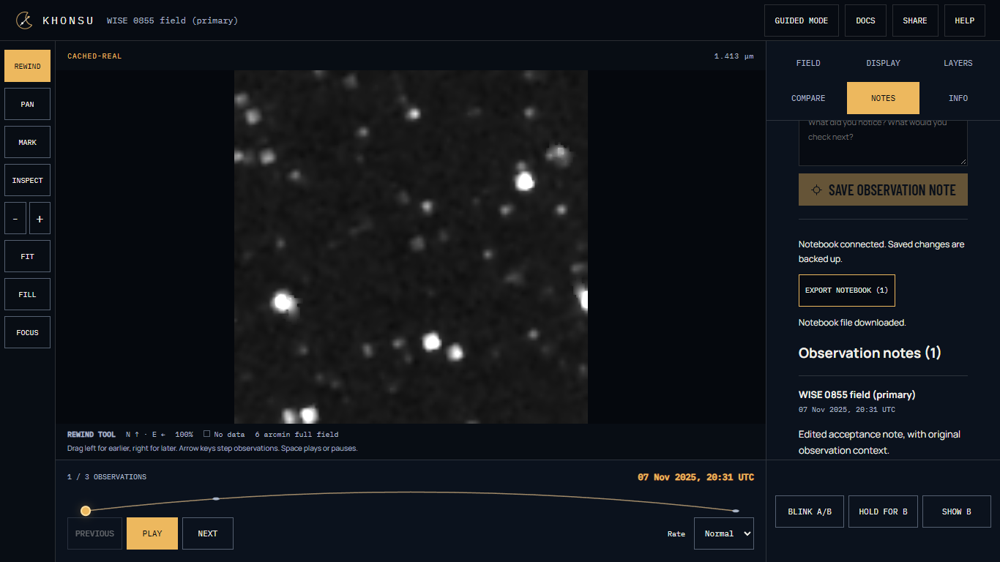
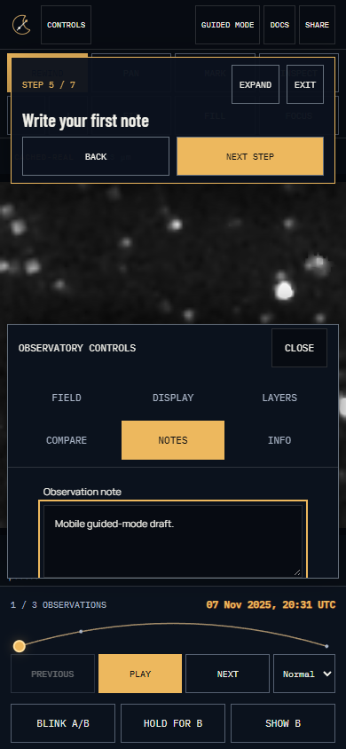

# Guided observatory and durable notebook

GitHub [#77](https://github.com/Sammieblz/khonsu/issues/77) and
Linear [BYT-54](https://linear.app/byteboyz/issue/BYT-54/improve-guided-observatory-durable-notes-and-spring-timeline)
track Samuel's five usability changes. The public guide is the static `/docs/`
page. Scientific pixels, quality masks and evidence interpretation are unchanged.

## Entry and guidance

The first Explore action of a page visit starts navigation and data loading
immediately, then shows the original guardian and sky sweep for three seconds.
Ready images wait behind it. Skip, Escape, Cancel, failure, leaving the console
and hiding the page can dismiss it early. Reduced motion skips the intro.
Returning to a loaded session also skips it. The guardian appears only in this
entry composition; later loads retain real progress, elapsed time and recovery
actions without replaying the character.

Guided mode in the console header opens seven steps: real observations, dates,
display, quality, observation notes, marked candidates and evidence export.
Steps open the relevant inspector or tool. They do not invent data, create notes,
or claim that an unperformed action passed. Back, Next, Minimize and Exit remain
available. The small-screen inspector and guide reserve separate areas. The
guide is a nonmodal Base UI dialog, so visitors can try the actual controls.

The docs page covers the controls, all five challenge targets, image limitations,
coordinates and units, keyboard operation, testing, troubleshooting, storage,
privacy and source references. It exports as static HTML with the frontend.

## Notes and storage

An observation note can be saved without a marked pixel, including before loading
a sequence. With a sequence, it captures the manifest and displayed frame. These
are human notes, not astronomical detections. Candidate notes retain the existing
position, original validity, comparison and versioned evidence format.

Both kinds support editing, deletion and export. Observation notes allow 2,000
characters, candidates 500, with at most 200 of each. The candidate snapshot
retains its existing 2,000,000-character bound. Large manifest snapshots can hit
the overall request or browser storage bound before the record count.

`khonsu.notebook.v1` stores an atomic browser backup, random 256-bit access key,
database revision and pending-change flag. Existing `khonsu.candidates.v2` and
legacy records migrate through the existing validated parser. A compatibility
copy remains in the old key. Unreadable data is preserved for explicit download
or replacement. If browser storage is blocked, the app keeps in-memory notes
and allows export. A new key must be persisted before any upload.

The FastAPI service uses Python's standard-library SQLite. The database stores
only a SHA-256 hash of the private key and the bounded notebook document. The
key is sent in `X-Khonsu-Notebook`, never in shared URLs or notebook exports.
There is no account, recovery service or automatic cross-device sync. Clearing
browser data loses access to that database copy, so export first. Anyone with
the key has access to that notebook; use HTTPS outside local development.

The client saves locally before attempting a serial database write. A revision
check and SQLite `BEGIN IMMEDIATE` transaction reject conflicting writes with
409. The UI lets the visitor export, keep the page copy or explicitly load the
database copy. A concurrent edit during a read is preserved. Failed uploads
remain pending for an explicit retry; they are never labelled as saved.

## API contract

`apps/api/app/schemas.py` defines `ObservationNote`, `NotebookDocument`,
`NotebookRecord` and `NotebookWrite`. OpenAPI and TypeScript are generated
together. FastAPI uses one schema for input and output to preserve the existing
`SequenceManifest` name when snapshots also become request data.

| Request | Result |
| --- | --- |
| `GET /v1/notebook`, private key header | `{ "revision": 0, "document": null }` for a new key, or its saved document |
| `PUT /v1/notebook`, private key header and JSON | `{ "revision": N, "document": {...} }` requires the current revision; success returns revision N+1 |
| Stale revision | 409 `NOTEBOOK_CONFLICT`, no overwrite |
| Body over 4 MiB | 413 before JSON parsing, including streamed bodies |
| Invalid key/document | 422 validation error |
| Storage not configured or disk unavailable | 503 `NOTEBOOK_UNAVAILABLE`; browser copy and export remain usable |
| Database content capacity reached | 507 `NOTEBOOK_CAPACITY` |

A minimal PUT document is:

```json
{
  "revision": 0,
  "document": {
    "candidate_snapshot": "{\"schema\":\"khonsu-candidates\",\"version\":2,\"candidates\":[],\"sequences\":{}}",
    "observation_notes": []
  }
}
```

The service caps stored content at 256 MiB and 1,000 notebooks, uses parameterized
SQL and sends private, no-store responses. GET on an unknown key does not allocate
a record. The gateway permits PUT and the key header only on the notebook route;
other JSON requests keep their existing 16 KiB limit. Saved manifests are treated
as snapshots, never instructions to fetch their URLs or read client paths.

## Docker and durability

Compose sets `KHONSU_NOTEBOOK_DB=/app/data/notebooks.sqlite3` and mounts the named
`notebook-data` volume there. The non-root API user owns the directory. Container
restart, recreation and image rebuild retain the notebook. Removing that volume,
including `docker compose down -v`, removes its database. Do not do that to reset
an image-processing job.

For a consistent backup, use SQLite's backup API while the API runs:

```sh
docker compose exec api python -c "import sqlite3; a=sqlite3.connect('/app/data/notebooks.sqlite3'); b=sqlite3.connect('/app/data/notebooks-backup.sqlite3'); a.backup(b); b.close(); a.close()"
docker compose cp api:/app/data/notebooks-backup.sqlite3 ./notebooks-backup.sqlite3
```

Keep backups private. To restore, stop the API, replace its database on the same
named volume with the backup, preserve file ownership, then restart. The browser
may ask which copy to keep if its revision differs. Export its copy first.

The existing Cloudflare Container configuration leaves `KHONSU_NOTEBOOK_DB`
unset: its temporary disk is not a durable notebook. Public database persistence
requires a separately configured persistent backend. No service or paid resource
was provisioned in this pass. Local Docker persistence is enabled now.

## Time dial

The visible arc, continuous handle and pointer hit area share one coordinate
mapping. Dragging follows immediately; releasing uses Motion's short spring
(`duration: 0.25`, `bounce: 0.2`) to settle on the nearest real observation.
The animation never interpolates scientific frames or dates. New drags,
navigation, resizing and unmounting stop the previous spring. Keyboard and
reduced-motion changes are immediate. The handle uses transforms without
per-frame React updates.

The installed animate, animation-performance and pick-ui-library skills informed
this choice. Base UI continues to own dialogs, CSS the intro, and GSAP the
landing story. Motion 14.14.0 adds only the dial spring. References:
[Motion animate](https://motion.dev/docs/animate),
[SQLite appropriate uses](https://www.sqlite.org/whentouse.html),
[SQLite transactions](https://www.sqlite.org/lang_transaction.html).

## Reproduce acceptance

With the API and static frontend served on the browser-test origins:

```sh
node scripts/verify-guided-notebook.mjs
node scripts/verify-sky-motion.mjs
node scripts/verify-console-design.mjs
```

Set `PLAYWRIGHT_MODULE`, `CHROMIUM_EXECUTABLE`, `AXE_SCRIPT`,
`KHONSU_TEST_URL` and `KHONSU_TEST_API` for the local installation. Reports and
screenshots are written below ignored `.cache/` paths. These use authentic
cached images; network failures and cancellation jobs are explicitly injected
test controls. They do not prove live archive availability, physical-phone
performance or a completed public deployment.

The new API tests exercise isolated keys, hashed storage, restart persistence,
validation, body bounds and two writers racing at the same revision. Frontend
logic tests cover serialization, offline recovery, queued edits and conflicts.
Gateway tests exercise notebook-only methods/headers and streamed byte limits.
See [testing.md](testing.md) for the full repository checks.

Recorded acceptance on November 15, 2026 (America/New_York):

- 152 Python API and science tests passed in the Python 3.12 Docker runtime;
  generated contract check passed. One upstream test-client deprecation warning.
- 109 frontend logic tests and eight gateway tests passed. Frontend and gateway
  TypeScript checks passed; the frontend produced all static routes including
  `/docs/`.
- Chrome 157 and Firefox 153 passed notebook CRUD/export/reload, offline retry,
  explicit tab conflicts, candidate migration, blocked storage and preservation
  of a damaged backup. Seven tour steps, focus return, mobile note entry, skip,
  reduced motion, continuous drag and real-date settling passed without page
  errors. The docs axe WCAG 2.1 AA audit found no violations.
- Entry/request/cancel stress passed with Chromium at 4x CPU throttling and
  Firefox normally. Requests started during the intro, with no guardian in
  subsequent loading feedback. Existing console and Clean View suites passed
  in both browsers, including original mask/evidence behavior and responsive
  controls.
- Local Compose rebuilt and started both healthy services. The isolated notebook
  kept its exact revision and document through API container recreation, and
  the test note was removed afterward without touching visitor notebooks.

For a real container recreation check, run
`python scripts/verify-docker-notebook.py` against the local Compose app.
It creates an isolated test notebook, recreates only the API, verifies the saved
revision and removes its test note. Active temporary science jobs expire during
this test; it leaves visitor notebooks and the named volume in place.





