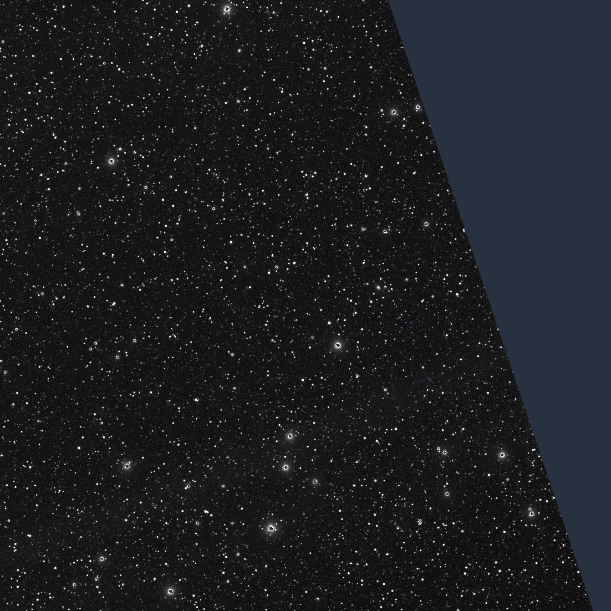

# Native wide fields and HD display

Scope: [GitHub #60](https://github.com/Sammieblz/khonsu/issues/60) /
[BYT-45](https://linear.app/byteboyz/issue/BYT-45), consolidated in
[PR #54](https://github.com/Sammieblz/khonsu/pull/54). Samuel authorized the final
cleanup and main integration on November 15, lifting the earlier testing hold.
The dedicated console design remains a separate planned phase.

## What changed

Search fields can span 0.5 to 120 arcminutes. CPython requests a padded native
cutout, preserves its calibrated values and flags, and registers compatible
epochs onto a shared grid up to 2048 x 2048. The browser can render up to 2160
pixels on its longest side, including a 1920 x 1080 display when that is the
viewport's aspect ratio. Square sky fields stay square.

The sampling readout distinguishes measured native sampling, prepared pixels and
display pixels. Native Scale and a clickable full-field overview help navigate a
large image. The current pane uses its available width. The separate screen-fit
console route and redesigned dock remain planning tickets, not delivered UI.

A larger display alone cannot make a 6-arcminute cutout into a detailed 1080p
observation. That field has about 58 native samples across. Wider fields contain
more measured sky while individual stars retain SPHEREx's native optical and
detector resolution. No sharpening, hidden inpainting or invented observations
are used to claim extra resolution. The previous 6-arcminute cached examples
remain unchanged.

## Reproducible real-data check

On November 15, 2026, two previously validated WISE 0855 field exposures were
retrieved again as 3-degree padded cutouts for a 2-degree requested field. This
is not a new target search or a moving-object detection.

| Property | Recorded result |
| --- | --- |
| Requested center | ICRS RA 133.7601213914074, Dec -7.242127941212259 degrees |
| Sources | DR1 detector 2, `2025W45_2A_0292_2` and `2025W50_2A_0479_1` |
| Start epochs | 2025-11-07 20:31:27.206400 UTC; 2025-12-13 05:32:45.657600 UTC |
| Downloaded science shapes | 1658 x 1219 and 1657 x 1224 |
| Download total | 72,685,440 bytes |
| Measured native scale | 6.133921249050374 arcseconds/pixel |
| Approximate native samples across requested field | 1173.8 |
| Prepared grid | 2048 x 2048, 3.515625 arcseconds/grid pixel |
| Masked fractions | 22.13% and 21.95% |
| Local CPython processing time | 33.62 seconds; excludes acquisition |

[Acquisition evidence](evidence/hd-field/acquisition.json) includes exact URLs,
checksums, WCS, real dates, software versions and processing settings. Large FITS
and binary products stay in `.cache/hd-field`, rather than repository history.
The existing cache's center is used intentionally; it is not a silent change to
the challenge's catalog coordinates.

Spectral compatibility is checked at the requested center. Wavelength varies
across each detector image, so agreement at the center does not establish
identical spectral responses elsewhere in a wide field. PSFs and backgrounds
remain unmatched, and propagated uncertainties are unavailable. The masked
regions remain visible and cannot be interpreted as recovered measurements.

## Resource bounds

| Boundary | Limit |
| --- | --- |
| Requested field / padded cutout | 120 / 180 arcminutes |
| Downloaded FITS file / all downloads per job | 64 / 256 MiB |
| Prepared raster | 2048 x 2048, 20 MiB including mask |
| All output grid pixels per job | 25,165,824, unchanged |
| Browser prepared-frame cache | Three frames for large rasters; five for small |
| Display longest side | 2160 pixels |
| Frontend requested exposures | 16 at <=30 arcmin; 8 at >30; 4 at >60 |

The API still accepts its existing frame-count contract and rejects workloads
that exceed the processing budget. Fewer requested exposures can reduce the
chance of finding spectrally compatible epochs. No coverage, archive timeouts
and resource limits are reported instead of substituted data. The job deadline,
queue bounds, allowlisted archive hosts and cached-bundle size limit are retained.

## Re-run and inspect

Use the installed scientific requirements and run from the repository root:

```sh
python scripts/verify-hd-field.py --download
python scripts/verify-hd-field.py
node scripts/verify-hd-display.mjs
node scripts/verify-hd-display.mjs --inspect
```

Only `--download` permits acquisition; subsequent runs verify the recorded
checksums and reuse local source FITS. The browser script needs the static
frontend, local API, and Playwright environment described in
[console acceptance](console-acceptance.md). It replays the job transport using
the real CPython products. It does not claim a live query or public deployment.

`--inspect` opens a disposable interactive Chromium window using those same
recorded real products, with a persistent local-replay banner. This offers a
repeatable manual review without an archive query. Close that window to stop.
It keeps the user's existing browser notes and sessions separate.

For manual testing, open the current preview, enter the center above and a
120-arcminute field, then choose Explore the sky. After a successful real search,
inspect the sampling readout, Native Scale, zoom overview, Show A/B and Rendering
mode under Image Display. Compare to a 6-arcminute cached example without
expecting the smaller field to gain source detail. Test the preserved experiment
at `/resolution-lab/` separately.

A separate live 120-arcminute request on November 15 reached scientific processing
but returned `INSUFFICIENT_COMPARABLE_EPOCHS` with the four-exposure request budget.
That is recorded in [live-query evidence](evidence/hd-field/live-query.json).
It establishes the bounded failure path, not successful live wide-field coverage.

## Acceptance recorded for this pass

- Python/API: 121 tests passed, including 1080-grid intensity/mask preservation,
  the 120-arcminute boundary and rejection of excessive total output pixels.
- Frontend: 83 tests passed; TypeScript and the production static build passed.
- [HD browser replay](evidence/hd-field/browser.json): Chromium 157 and Firefox
  153 rendered the real 2048-square products, checked 1080 displayed-mask probes,
  used a 1174-square native-scale display, and passed overview, A/B, CPU worker,
  GPU restoration, candidate lineage and mobile overflow checks.
- [Console](evidence/hd-field/observatory.json),
  [candidate integration](evidence/hd-field/candidate.json),
  [enhancement](evidence/hd-field/enhancement.json), and
  [resolution lab](evidence/hd-field/resolution-lab.json) passed in both browsers.
- [Accessibility](evidence/hd-field/accessibility.json): zero tested axe
  violations or page overflow at 390, 820 and 1440 pixels; 44-pixel controls,
  reduced motion and keyboard load/step/mark/save/export with visible focus passed.
- Generated contracts and repository text/link checks passed. Reports were
  captured from the working tree based on integration commit `a46b3bb`; source
  hashes are included where the suite records them.

The overview and main PNG loader now share anonymous CORS settings, preventing
the thumbnail cache from breaking reloaded frames. A single post-commit React
effect hands focus to the newly mounted console; the older RAF could fire before
the entry button disappeared. Both corrections are covered by browser acceptance.



The image above is the real rendered field, captured directly from the canvas.
The slate wedge is uncovered detector area. [Mobile console capture](evidence/hd-field/mobile.jpg)
shows the existing controls. The dedicated screen-fit console remains a future
design ticket.
