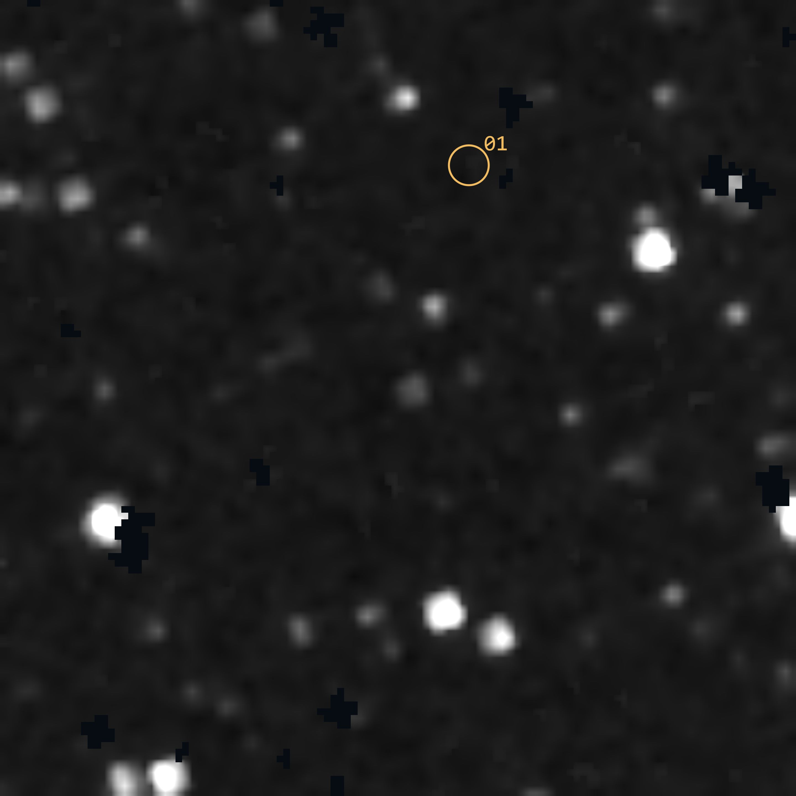
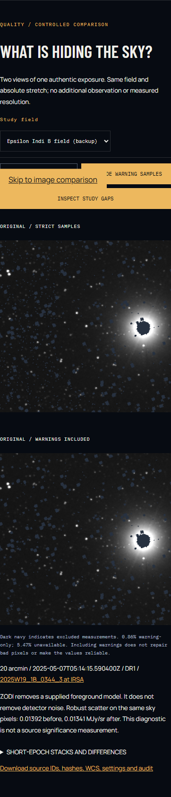

# Image quality, warning masks and bounded 4K

Owner: Samuel Ndubuisi. [GitHub #64](https://github.com/Sammieblz/khonsu/issues/64)
and [BYT-49](https://linear.app/byteboyz/issue/BYT-49). This pass follows PR #54
and preserves its shared WCS, actual dates, candidate coordinates and console.

## What changes for a visitor

The default gap color is dark navy, RGB 7/11/18. Image Display offers Inspect
slate and Detailed hatch when someone wants the excluded pixels to stand out.
Gaps remain explicit, discrete and unfilled. A dark gap is not measured dark sky.

Quality policy starts with strict samples. Include warning-only samples reveals
finite IMAGE values whose only adverse flags are OUTLIER or OVERFLOW. These flags
are propagated in IRSA's mosaic recipe. Unknown flags, other bad flags, missing
values and nonpositive/nonfinite variance remain unavailable. Warning values
cannot change strict samples through interpolation or detail enhancement.
Candidate marks and exports retain `pixel_has_data: false` plus
`pixel_quality: warning-only`; changing display policy never grants validity.

Adaptive display starts with the HD budget, up to 2160 pixels on the longest
side. It measures rendering, canvas composition and the next animation-frame
opportunity. A WebGL2 interval at most 32 ms permits the larger budget; an interval
over 100 ms or CPU fallback locks adaptive mode to HD until the rendering or
resolution choice is reset. This is a conservative responsiveness heuristic, not
a GPU kernel timer. Manual HD and 4K remain available.

4K is bounded by both 3840 pixels per side and 8,294,400 total pixels. A 16:9 image
can be 3840 x 2160; a square sky field is 2880 x 2880. No aspect ratio distortion
or extra native measurements is introduced. The CPU worker can render that size
but is substantially slower. Automatic mode does not assume a GPU is fast merely
because one exists.

## Prepared contract and lineage

`float32-le-quality8-v2` retains the five-byte-per-pixel layout: one little-endian
Float32 plane followed by quality bytes, top-left row-major order. States are
0 unavailable, 1 strict-valid and 2 warning-only. State 0 values are zero-filled
for transport only. The v1 binary mask decoder remains supported.

`Frame.warning_fraction` is a subset of `masked_fraction`, since the latter
continues to mean excluded from strict measurements. The pipeline is
`khonsu-display-0.5.0`. PNG alpha, aligned FITS VALID and shared stretch remain
strict. Browser preparation carries the additional warning samples separately.
Python schemas, OpenAPI and TypeScript are regenerated together.

Both saved examples now carry v2. Their original PNGs, source manifests,
acquisition records, strict intensities, grid and timestamps are preserved.
Each bundle's `lineage.json` records raw-source hashes, quality fractions and
the strict-sample equivalence check. Reacquired cutout bytes are recorded under
their actual hash rather than substituted for an older acquisition checksum.

Reproduce the upgrade from reviewed raw cutouts:

```sh
python scripts/prepare-quality-examples.py
# Only if a named cutout is absent:
python scripts/prepare-quality-examples.py --download
```

The latter permits at most five fixed IRSA URLs, 16 MiB each, 80 MiB total and
300 seconds. This run reused two existing inputs and acquired three more. It
refuses an upgrade if strict geometry or intensities do not reproduce the cache.
The earlier `prepare-browser-examples.py` remains a legacy v1 reproducibility
tool and must not be run over an upgraded bundle.

## Real comparison and the coadd limit

The [reproducible report](evidence/quality/experiment.json) and
`/resolution-lab/#quality-study` compare IMAGE against IMAGE-ZODI with the same
WCS and absolute stretch. Separate controls include warning samples and inspect
gaps. This is a research comparison; live playback is not silently switched to
background-subtracted data.

| Diagnostic | WISE 0855 field | Epsilon Indi B field |
| --- | --- | --- |
| Field compared | 20 arcmin | 20 arcmin |
| Warning-only grid samples | 1.45% | 0.86% |
| Unavailable grid samples | 1.64% | 5.47% |
| Fixed-sky robust scatter before | 0.00868 MJy/sr | 0.01392 MJy/sr |
| Fixed-sky robust scatter after ZODI subtraction | 0.00871 MJy/sr | 0.01341 MJy/sr |

ZODI subtraction removes the supplied smooth foreground model. It does not
remove detector noise, recover a masked star core or improve optical resolution.
These diagnostics do not establish photometric errors or source significance.
The existing 6-arcminute WISE example has 1.39-1.59% warning-only samples across
its three frames; the Epsilon Indi example has none within that smaller crop.

`processing/composites.py` implements a bounded inverse-variance mean on a shared
grid. It requires 2-16 distinct exposures, one detector and release, at most 24
hours, and target/per-pixel wavelength spread at most 0.1 of the minimum bandwidth.
The research adapter uses nearest native samples so it does not pretend that
bilinear variance interpolation propagated uncertainty. It emits coverage,
weights, diagonal variance, source records and the actual earliest/latest times.
PSF changes, model uncertainty and output-pixel covariance remain unaccounted for.

The real audit inspected 43 cached files in four fields and tested 219 pairs.
Every pair failed the target wavelength criterion. Five previously attempted
inputs were unavailable. No real stack is claimed. The synthetic controls verify
noise reduction, flux preservation, measured gap coverage, and time/wavelength/
duplicate rejection. They are not evidence of real SPHEREx resolution recovery.
PSF-matched differences remain unavailable: there is no accepted coadd pair in
this bounded sample and no validated full-field PSF matching/residual significance.
Broader compatible archive coverage may exist.

```sh
python scripts/experiment-quality.py
```

This command is offline and checks cached acquisition hashes. Full settings,
dates, WCS and source links appear in the JSON report. The scientific basis is
the [IRSA mosaic guide](https://irsa.ipac.caltech.edu/onlinehelp/spherex/spherex/mosaic.html),
[SPHEREx explanatory supplement, section 3.4](https://irsa.ipac.caltech.edu/data/SPHEREx/docs/SPHEREx_Expsupp.pdf),
and [release product definitions](https://caltech-ipac.github.io/spherex-archive-documentation/spherex-data-products/).

## Test in Docker

```sh
docker compose up -d --build
docker compose ps
```

1. Open `http://localhost:3000`, hard-refresh, and load the cached real WISE field.
2. Open Image Display. Compare Subdued gaps, Inspect slate and Detailed hatch.
3. Switch Quality policy between Strict samples and Include warning-only samples.
   Some WISE gaps become visible values; hard-invalid gaps remain.
4. Select 4K budget. The square display readout becomes 2880 x 2880. Compare Smooth
   and Pixels, then return to Adaptive. Select CPU to verify the fallback readout.
5. Mark a warning-only sample. Its note must say warning-only and its evidence
   must keep `pixel_has_data: false`. Blink A/B and inspect the real exposure dates.
6. Open `http://localhost:3000/resolution-lab/#quality-study`. Toggle ZODI, warnings
   and gap inspection. Download the report to inspect the unsuccessful coadd audit.

Browser checks use the [documented external Playwright setup](console-acceptance.md):
`node scripts/verify-quality-display.mjs`, plus enhancement, candidate, observatory,
wide-field, resolution-lab and accessibility regressions. The quality suite reads
back real pixels, compares GPU/CPU outputs, exercises 4K and verifies warning marks.
Acceptance on November 15, 2026:

- 127 Python tests and 87 frontend tests passed, including legacy v1 decoding,
  warning/strict separation, coadd controls, stored note validation and exports.
- TypeScript, static export, generated contracts and repository checks passed.
- Chromium and Firefox passed [quality and 4K](evidence/quality/browser.json),
  [enhancement and slow-CPU A/B](evidence/quality/enhancement.json),
  [candidate/display](evidence/quality/candidates.json),
  [observatory](evidence/quality/observatory.json),
  [wide-field](evidence/quality/hd.json) and
  [resolution-lab](evidence/quality/resolution-lab.json) checks.
- [Accessibility](evidence/quality/accessibility.json): no detected WCAG 2.1
  A/AA violations at mobile/tablet/desktop, no overflow or undersized primary
  controls, and keyboard load/step/mark/save/export passed. The new quality
  study also passed its scoped axe check in both browsers.

The tested quality-renderer modes agreed exactly at the sampled comparison
size. One cold 3840 x 2160 render plus 2D copy and synchronous readback took
about 165/139 ms on WebGL2 and 1069/1632 ms on the CPU worker in Chromium/Firefox.
These measurements include readback and are not animation frame-rate promises.
The browser exposed an AMD Radeon adapter; GPU rendering was active.




