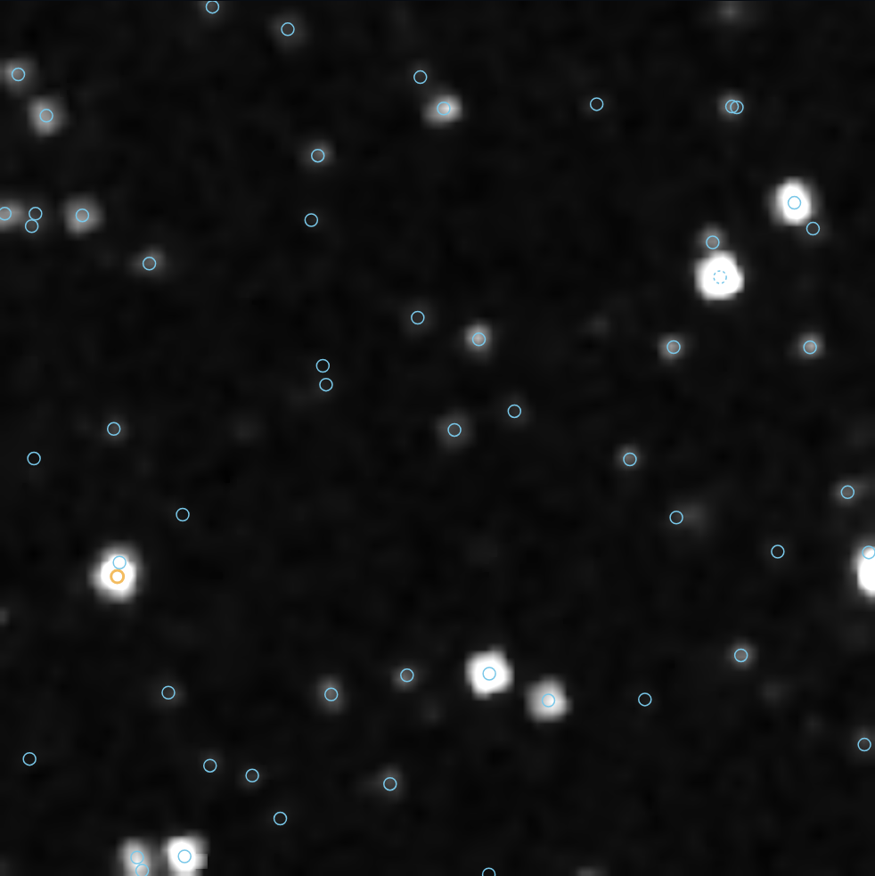
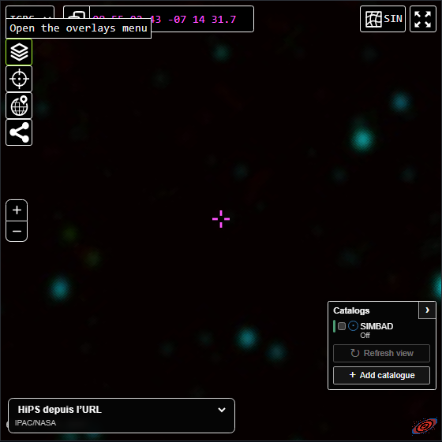
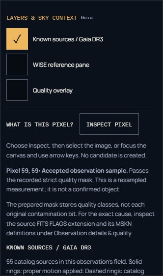
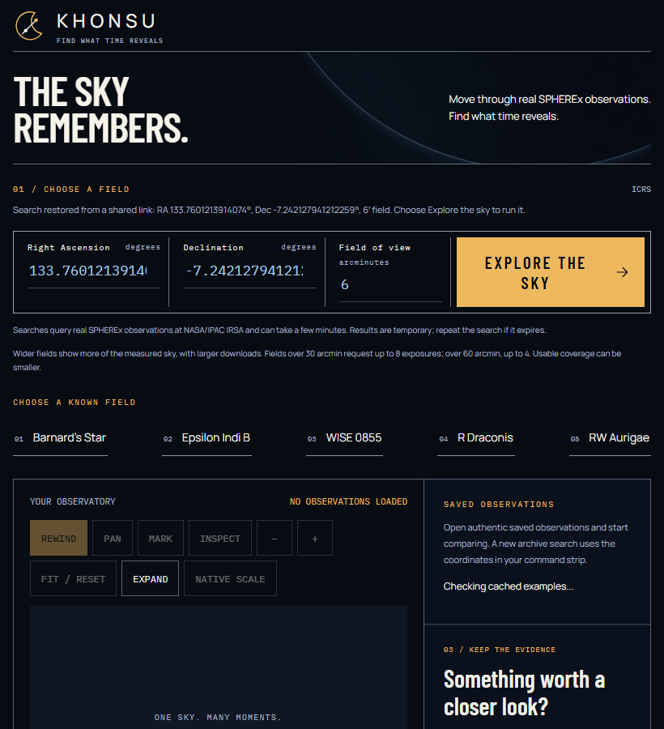

# Sky context, quality inspection and embedding

GitHub [#72](https://github.com/Sammieblz/khonsu/issues/72), Linear
[BYT-53](https://linear.app/byteboyz/issue/BYT-53). Owner: Samuel Ndubuisi.
This is a scoped optional context integration authorized after the SPHEREx
viewer and bounded patch completion. Original observations and candidate
measurement validity remain unchanged.

## Use the controls

1. Open a real cached example or finish a live coordinate search.
2. Open **Layers & sky context** above the image.
3. Enable **Known sources / Gaia DR3**. Rings identify catalog positions. Select
   a ring in Pan/Rewind or choose a source from the accessible list to inspect
   its identifier, epoch, magnitude and proper motion. Dashed rings mean motion
   data was unavailable. The layer is initially off and never auto-detects objects.
4. Choose **Inspect** and select an image pixel, or use the canvas arrow keys.
   The quality explanation distinguishes accepted measurements, warning samples,
   visual estimates and unavailable samples. Inspect does not create a candidate.
   Enable **Quality overlay** for amber warning samples, blue estimate locations,
   and violet unavailable pixels. Text explains the same classes without color.
5. Enable **WISE reference pane** for the same sky center and field in CDS
   Aladin Lite. It is an independently navigable reference. **Reset / retry
   reference** returns to the SPHEREx field. SPHEREx playback never follows the
   reference pane's navigation or interprets its atlas as a new observation.
6. **Share this field** offers a coordinate link, compact preview and iframe
   markup. Opening either restores the form, with no automatic archive download.
   The optional observation ID selects a returned observation only if present.

## Scientific and service boundaries

The Gaia layer uses the [Gaia DR3 main catalog in VizieR](https://vizier.cfa.harvard.edu/viz-bin/VizieR?-source=I/355/gaiadr3)
at the official Harvard mirror. ESA Gaia and DPAC produced the catalog; CDS
VizieR distributes it. The response retains provider, exact reproducible query,
retrieval UTC, catalog reference positions at J2016.0, magnitude and motion
components. Gaia identifiers are strings because they exceed JavaScript's exact
integer range. This work uses ESA Gaia data processed by DPAC and the VizieR
catalog service at CDS. See [Gaia attribution](https://www.cosmos.esa.int/web/gaia-users/credits)
and [VizieR dataset citation](https://doi.org/10.26093/cds/vizier.1355).

Astropy propagates available proper motion to each SPHEREx exposure start, then
projects through the exact common WCS and raster flip. Annual parallax,
perspective acceleration, orbital motion and uncertainty propagation are not
applied. A ring is approximate context, not an automatic cross-match. Missing
motion leaves the position at the catalog epoch. A missing Gaia source does not
establish a discovery, especially for an infrared object.

The cone covers actual WCS corners plus a 6 arcmin catalog-motion margin, capped
at 2 degrees. Very fast objects outside the margin can be missed. Queries request
501 rows sorted by G magnitude, retain at most 500 before grid clipping and
explicitly report truncation. Transfers are limited to 1 MiB, a 15 second socket
timeout and a checked 25 second transfer budget. Two server lookups may run at
once. A maximum of 16 successful responses are cached for 10 minutes. Redirects
are refused. Requests accept only existing server-controlled sequence IDs, never
arbitrary positions, SQL, URLs, paths or WCS headers. The browser aborts after
35 seconds. Empty, failed and truncated catalogs have different explanations.

Live checks on November 15, 2026 found IRSA Gaia TAP and AIP synchronous queries
timing out. The verified Harvard and IDIA VizieR mirrors returned the catalog.
Runtime uses one fixed Harvard endpoint; it does not silently substitute a
different release. SPHEREx archive acquisition still uses IRSA.

The [IRSA AllWISE color HiPS](https://irsa.ipac.caltech.edu/data/hips/CDS/AllWISE/RGB-W4-W2-W1/properties)
uses W4 red (22 microns), W2 green (4.6 microns), and W1 blue (3.4 microns).
It combines 2010-2011 exposures; dates and coverage differ by band and position.
It is not a single epoch. WISE/NEOWISE data are from NASA/JPL-Caltech, UCLA and
IPAC; CDS generated the HiPS visualization and hosts the Aladin reference viewer.
See the [AllWISE overview](https://irsa.ipac.caltech.edu/data/WISE/docs/release/AllWISE/expsup/sec1_1.html).
The pane cannot fill missing SPHEREx measurements or establish cross-mission
brightness changes. The host controls the Aladin version; the pane is isolated
in a third-party iframe, created only when enabled and removed when disabled.
Khonsu does not bundle Aladin or change its existing MIT license/dependencies.
An iframe load event cannot prove its remote tiles loaded, so the interface
keeps retry/external-open guidance instead of declaring its image scientifically ready.

The original source FLAGS bitmap is not included in the prepared raster. The
inspector therefore explains the retained quality class rather than guessing a
per-bit reason. Users can open the original FITS from Observation details and
inspect its FLAGS/MSKN definitions. Display estimates remain excluded from strict
measurement validity, including when an estimated hole visually disappears.

## Additive API

`GET /v1/examples/{example_id}/context/gaia` and
`GET /v1/sequences/{sequence_id}/context/gaia` return `GaiaContext`.
Schemas, OpenAPI and TypeScript declarations are generated together.

```sh
curl http://localhost:8000/v1/examples/real-wise-0855/context/gaia
```

The response contains `sequence_id`, `catalog`, `provider`, `retrieved_at_utc`,
`query_url`, `query_radius_deg`, `truncated`, `notes` and `sources`. Each source
contains string `source_id`, `ref_epoch`, catalog ICRS coordinates, motion,
optical G magnitude, `position_method` and only the in-grid per-frame `positions`.
Positions have `frame_id`, zero-based pixel-center `x/y`, and epoch RA/Dec.
HTTP 429 means the optional context service is busy; 503 means an upstream or
projection failure; 404 means the cached field is unavailable. Live job routes
retain the existing expired/missing job behavior. These failures do not discard
the loaded SPHEREx sequence or its original pixels.

## Compact static sharing

`embed=1` hides landing content and retains coordinate entry, the original viewer,
cached examples, controls and evidence tools. It is a layout of the same static
page, not another state implementation. For example:

```text
http://localhost:3000/?ra_deg=133.7601213914&dec_deg=-7.2421279412&fov_arcmin=6&frame=ICRS&embed=1
```

Links omit private notes, obsolete URL parameters and temporary job IDs. Sharing
a cached field creates a new archive query, with that difference stated in the
UI. It does not promise the exact cached sequence will be returned. Copied HTML
escapes URL attributes; clipboard failure exposes selectable text. A public
embed requires a reachable frontend/API origin and host headers that permit
framing. No hosting or access policy is changed by this feature. The dedicated
console-page redesign remains tracked separately in #61.

## Verification

`test_catalog_context.py` uses explicitly controlled catalog rows to test large
IDs, missing motion, truncation, error bodies, busy limits, caching and coordinate
registration near RA zero and the poles. `context.test.ts` verifies quality
classes, input immutability, query restoration and safe compact links.

`node scripts/verify-context.mjs` checks the real cached SPHEREx fields and live
Gaia context in Chromium and Firefox, marker registration at fit and zoom,
quality inspection, independent outage/retry, real WISE tiles and restored
embed coordinates without auto-starting an archive job. Set `PLAYWRIGHT_MODULE`,
`KHONSU_TEST_URL`, `KHONSU_TEST_API` and `KHONSU_TEST_OUTPUT` as for the other
browser suites. It requires the external catalog and reference services.
Injected outage responses are test controls, not observational evidence.

### Recorded acceptance, November 15, 2026

- 147 backend tests and 94 frontend tests passed, along with type checking,
  static export, generated-contract agreement and the repository text/link check.
- [Live catalog records](evidence/sky-context/live-catalogs.json) contain 55
  in-grid Gaia sources for the WISE 0855 field and 64 for Epsilon Indi B. Both
  queries hit the stated 500-row cap before clipping. Exact returned context
  snapshots are [primary](evidence/sky-context/gaia-context-0.json) and
  [backup](evidence/sky-context/gaia-context-1.json). These are catalog context,
  not identification or detection of the named brown dwarfs.
- [Chromium 151 and Firefox 153](evidence/sky-context/browser.json) passed live
  context acceptance. Screen marker centers agreed with the projected grid
  within 0.03 CSS pixels at fit and zoom. The science canvas was byte-identical
  with Gaia enabled. Both loaded real WISE atlas tiles at the requested center,
  field and aspect ratio, recovered from an injected catalog outage, and opened
  the compact page inside the generated iframe without starting an archive job.
- [Clean View regression](evidence/sky-context/clean-view.json) passed in both
  browsers, including the four formerly missing patches, original comparison,
  marking and 160 CPU/GPU comparisons per browser (maximum difference 1 byte).
  No measured display pixels changed when enabling Clean View.
- [Accessibility](evidence/sky-context/accessibility.json) passed at 390, 820
  and 1440 pixels, with no page overflow, sub-44-pixel tested controls or axe
  violations. The keyboard journey loaded, stepped, marked, saved and exported
  evidence with visible focus. This audit covers Khonsu, not the third-party
  Aladin application's own controls.








