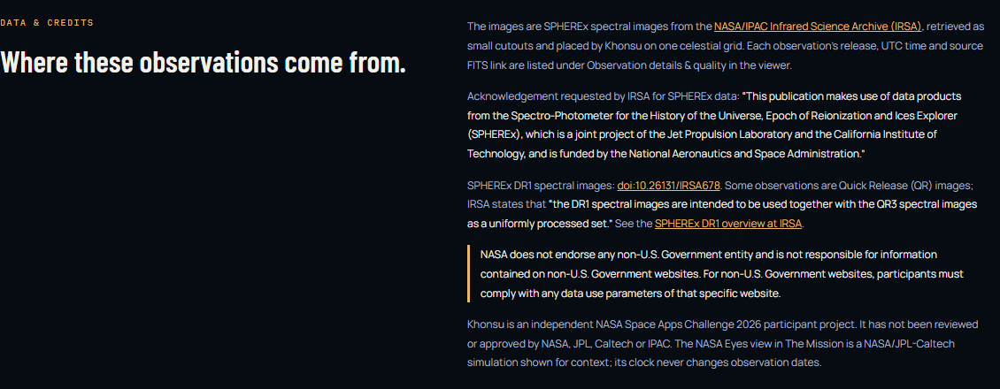

# Observation console interactions

Samuel's user-authorized integration pass extends Michael's viewer and Robel's
composition boundaries through GitHub #37 / Linear BYT-38. The parent
owns the manifest and selected frame; the console owns temporary interaction
state and resets it when sequence identity changes.

## Controls

- Rewind: horizontal image drag selects the nearest real epoch. The arc and
  slider map actual elapsed UTC time; date buttons and arrow keys also select
  repeated timestamps individually. Earliest/latest refer to available visits.
- Pan: drag, wheel or pinch to zoom; arrow keys pan, + and - zoom, 0 fits.
  Zoom is bounded to 1-8x and panning keeps the field reachable. Fit preserves
  the full aspect ratio; zoomed views explicitly identify cropping.
- Mark: click an image pixel, or focus the observation canvas and move the
  keyboard cursor with arrows, then Enter. The transformed canvas rectangle
  maps back to integer natural-raster coordinates. Pixel origin remains top-left.
  The selection also records the A/B frames and whether the verified raster has
  data at that pixel. Saved marks are drawn on every epoch of their sequence:
  solid on the marked frame, dashed elsewhere, cyan when selected.
- Playback: explicit Play/Pause, Previous/Next and rate. Playback waits for the
  selected image to load. It never starts automatically, including reduced motion.
- Comparison: select A/B, blink crisply or hold to show B. Releasing, cancelling
  or losing focus restores the frame held before comparison. View transforms
  remain shared between epochs. Blink waits for both assets and for the displayed
  frame to finish rendering before starting its viewing interval, including on a
  slow CPU. Timers stop on blur and sequence replacement.
- Image sampling: Smooth interpolates display intensities; Pixels shows nearest
  prepared samples. Both retain masks and natural-raster coordinates. The canvas
  follows viewport size, device pixel ratio and zoom with a 2160-pixel bound.
- Detail experiment: optional capped visual emphasis, off initially. Hold
  Original compares the same frame with detail off and unchanged stretch/sampling.
  Pointer release/cancel, key release and blur restore the prior display. Mark
  pauses detail automatically. Settings stay shared across genuine epochs.

The SVG time arc and accessible range input provide the same real-date mapping.
Unknown dates use an index fallback and remain labelled unavailable. The display
does not interpolate sources, crossfade observations or alter a celestial WCS.

**Comparison notes.** **Show A / Show B** switches between the pair with one press, for keyboard, touch and reduced-motion users who should not need to hold or blink. If A or B fails to load, blinking pauses with a message and a Retry button instead of waiting silently. Under the controls, `describeComparison` (`features/viewer/comparison.ts`) states in words:

- each side's date, observation ID, release, wavelength and missing data;
- how far apart the dates are;
- a DR1/QR3 pairing, quoting IRSA's statement that they are meant to be used together;
- a wavelength or detector difference;
- coverage gaps (either side at least 10% missing, or 5 points apart);
- each frame's own warnings;
- that PSFs and backgrounds are not matched;
- and that A and B are the same observation, when they are.

## Image resources and geometry

Load the current frame, previous/next and selected A/B, deduplicated to at most
five images, or three for large prepared rasters with current/A-B priority.
Both PNG and intensity loaders use the same cache-window policy. Abort obsolete
pending loads and prune images outside this set.
Sequence remounts discard all prior state and resources. Missing frames show a
visible retry state; old science pixels cannot appear under a new date.

The image, toolbar and timeline share one console width. Controls and provenance
sit outside the science raster. Original output dimensions and angular field
remain visible. No-data pixels use a distinct slate fill and legend. Optional
intensity controls consume the prepared arrays described in
[browser display](browser-display.md).
The [enhancement experiment](enhancement-research.md) documents the algorithms,
research findings, original comparison and actual rendering path.

## Provenance and quality

**Observation details & quality**, under the viewer, opens by default. Its labels and values come only from the manifest:

- a data-mode label in words: live archive result, cached real observations with their acquisition time, or synthetic development data;
- the target in ICRS degrees;
- the requested field, output grid and pixel scale;
- the shared display stretch and a processing summary.

A table lists every observation with:

- its UTC start time to the second;
- its observation ID, linked to the source FITS at IRSA;
- its release, detector, wavelength and band;
- its share of pixels without valid data;
- whether it is showing, A or B, in words rather than colour alone.

Quality notes repeat every sequence and frame warning with its code. Any frame with at least 10% missing data gets its own note. The full processing record is one click further. The page's field guide walks through load, rewind and blink, check quality, mark and export, and explains the difference between motion and brightness change. The Data & credits section carries IRSA's requested SPHEREx acknowledgement, the DR1 DOI and the NASA non-endorsement notice.

## Verification

Pure tests cover irregular/repeated epochs, bounded loading, transformed pixel
selection and pan limits. Browser checks use the authentic cached WISE 0855
sequence, keyboard marking, step controls, A/B hold restoration, blink and
390px layout. Desktop and narrow screenshots are in
[console evidence](evidence/console/controls-desktop.png) and
[mobile evidence](evidence/console/controls-mobile.png).

Candidate records, their ICRS conversion and local storage are described in
[candidate marks](integration.md#candidate-marks). Review source quality,
spectral compatibility and unmatched PSFs/backgrounds before interpreting
apparent change.

The display experiment incorporates #50's candidate contract on its feature
branch. Marker centers use independent horizontal and vertical display scales;
selection highlights trigger a redraw even when the active frame is unchanged.
The original validity plane and selected A/B IDs accompany each mark. Detail
remains paused in Mark mode. Candidate persistence begins only after the loaded
store is committed to React state, avoiding an initial empty write on reload.
See the [combined acceptance evidence](enhancement-research.md#candidate-integration).
